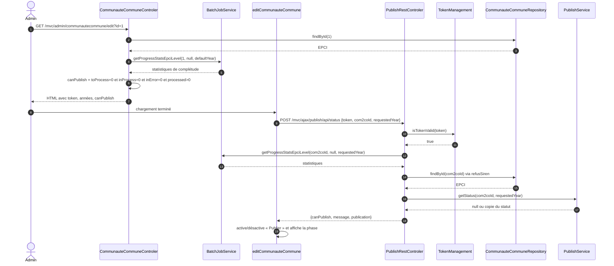
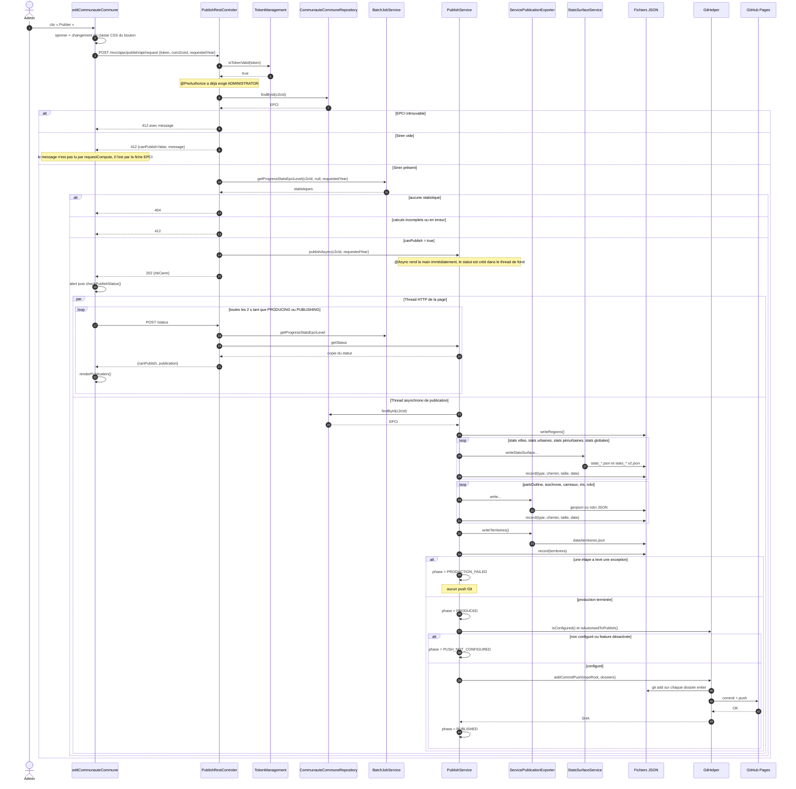
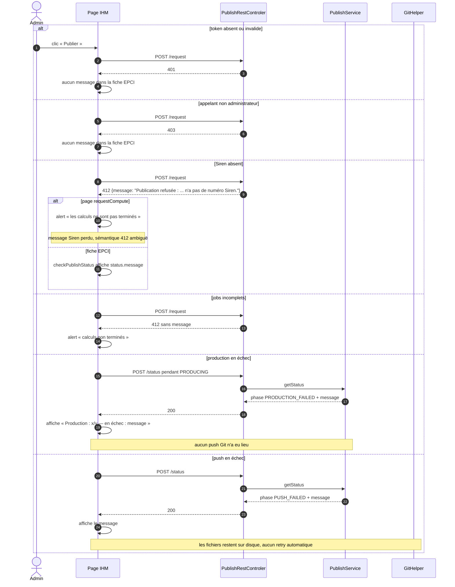
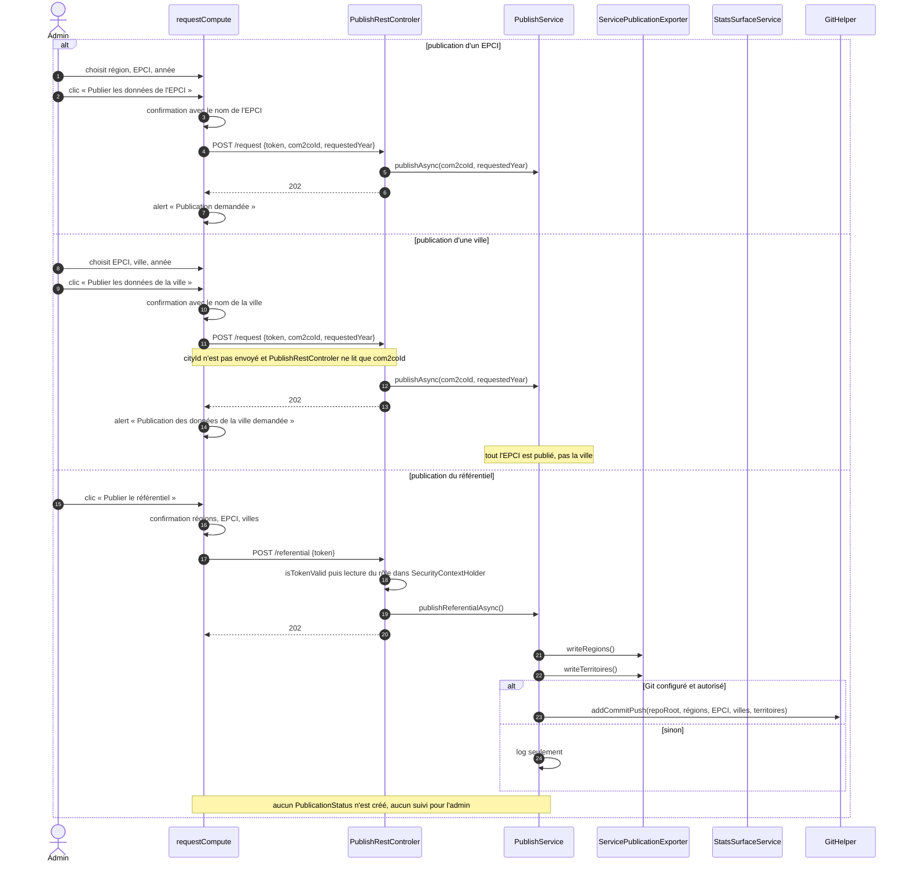
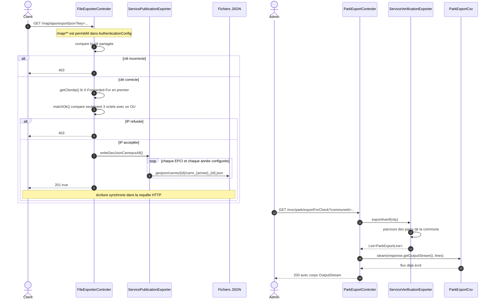
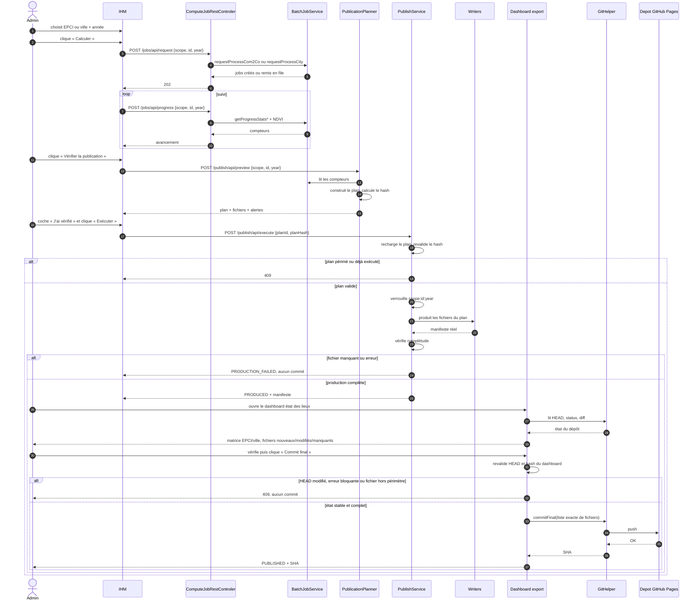

# Revue — Exports depuis l'IHM et pseudo-tests `AdmUtil*`

Document de cadrage / revue technique.
Date : 2026-11-22.
Périmètre : `geoservice-isochrone-v2` (backend Spring Boot, templates Thymeleaf, tests).
État revu : working tree au 2026-11-22, y compris les changements non commités (garde Siren, statistiques v2, messages d'erreur IHM).
Statut : **revue seule**. Aucun code applicatif n'est modifié par ce document.

## 1. SCOPE

### Dans le périmètre

- Les exports déclenchés depuis l'IHM administrateur :
  - publication d'un EPCI depuis la fiche `editCommunauteCommune` ;
  - publication depuis la page « Lancement de calcul » (`requestCompute`) ;
  - publication du référentiel ;
  - export legacy `/map/ajax/export/json` (déclenchement HTTP, pas bouton) ;
  - export CSV des parcs `/mvc/park/exportForCheck` (endpoint non relié à un bouton).
- Les pseudo-tests `AdmUtil*` de `src/test/java` : `AdmUtilExporterApplication`, `AdmUtilGeoserviceIsochroneApplication`, `AdmUtilIrisApplication`, `AdmUtilSolverApplication`, `AdmUtilOverpassIntegration`, `TestAdmUtilCsvParkEntranceUpdateParser`.
- Les tests unitaires réellement exécutés sur ces sujets (`TestPublishService`, `TestStatsSurfaceV2Writer`, `TestServicePublicationExporter*`, `TestParkExportCsv`).

### Hors périmètre

- Les calculs de carreaux, d'isochrones et de NDVI eux-mêmes. Seuls leurs effets d'écriture sont revus.
- Le front Vue 3 (`geoservice-map-vue3`) et le contrat public `geoservice-data`. Les chemins produits sont vérifiés, pas le rendu.
- La correction du code. Les correctifs proposés sont des décisions à arbitrer, pas des patchs.

### Convention de sévérité

| Niveau | Sens |
|---|---|
| **Bloquant** | L'action IHM ne fait pas ce qu'elle annonce, ou produit un résultat faux de façon systématique. |
| **Élevé** | Perte de données, publication partielle, commit hors périmètre ou faille d'accès. |
| **Moyen** | Comportement dégradé, diagnostic difficile, incohérence de contrat. |
| **Faible** | Dette de lisibilité ou de documentation. |

## 2. SYNTHÈSE

Quatre constats dominent.

1. **L'IHM propose deux parcours de publication qui ne publient pas la même chose.** La fiche EPCI publie un EPCI et une année. La page « Lancement de calcul » propose « Publier la ville », mais envoie seulement `com2coId` : elle publie tout l'EPCI. Le libellé et la confirmation mentent sur l'effet réel (**F-01**).
2. **Le périmètre du commit Git est plus large que celui annoncé.** `PublishService` stage des dossiers entiers, toutes années confondues, et `writeRegions()` réécrit tout le référentiel à chaque publication. Un clic sur un EPCI peut donc commiter des fichiers d'autres EPCI ou d'autres années déjà présents dans le working-copy (**F-04**). Cela contredit le scénario `01.2` du cadrage `publication-geojson-github-epci-framing.md`.
3. **Le statut de production ne bloque pas réellement une publication incomplète.** Les échecs par ville sont avalés dans `StatsSurfaceService` ; les GeoJSON vides ne sont pas écrits ; `produce()` enregistre alors un fichier `produced=false` sans message, et `PublicationStatus.hasProductionError()` n'est jamais utilisé. La phase passe quand même à `PRODUCED`, puis le push part (**F-03**).
4. **La provenance des JSON publiés est mixte et non traçable.** Deux voies ont produit des fichiers : le run manuel `AdmUtilExporterApplication.writeLiveDataByCom2coAndYear` (EPCI 1, 2021) et l'export IHM « écran EPCI » (`PublishRestControler` → `PublishService`), déclaré viable par le mainteneur. Aucun manifeste ne dit quel fichier vient de quelle voie. L'outil manuel ne produit ni référentiel, ni NDVI, ni `territoires.json` ; l'export IHM les produit. Le dépôt `geoservice-data` ne contient aujourd'hui aucun `.v2.json`, `data/territoires.json` n'y est pas suivi, et les commits observés sont manuels (`chore(2021): add 2021 data`, `feat: ndvi`) : le push automatique de l'export IHM n'est donc pas prouvé par l'historique (**T-02**, section 3.1).

Les pseudo-tests `AdmUtil*` ne rattrapent rien : la plupart ne sont **pas exécutés par `mvn test`** (nommage hors motifs Surefire), les autres sont `@Disabled`, et ceux qui pourraient tourner écrivent dans la base ou le répertoire d'export configuré sans assertion ni nettoyage (**T-01** à **T-06**). L'outil manuel reste l'un des producteurs utilisés : la donnée publiée dépend donc encore d'un code hors build.

Points solides à conserver :

- La séparation production / push Git, avec un statut par fichier, est un bon modèle.
- La garde Siren est présente aux deux niveaux (contrôleur et service asynchrone), donc un appel direct à `publishAsync` ne contourne pas le refus.
- Les tests unitaires `TestPublishService` couvrent correctement l'échec de production, l'absence de configuration Git et la publication nominale.
- Le contrat statistiques v2 est testé sur ses invariants (identité officielle, bornes numériques, absence de couleur).

## 3. CARTOGRAPHIE DES EXPORTS

| # | Écran / entrée | Action visible | Endpoint | Effet réel | Auth |
|---|---|---|---|---|---|
| 1 | `editCommunauteCommune.html:103` | « Publier » (EPCI + année) | `POST /mvc/ajax/publish/api/request` | Écrit référentiel + stats + GeoJSON + NDVI + index, puis push Git | `@PreAuthorize ADMINISTRATOR` + token |
| 2 | `requestCompute.html:133` | « Publier les données de l'EPCI » | idem #1 | idem #1 | idem #1 |
| 3 | `requestCompute.html:136` | « Publier les données de la ville » | idem #1, **sans `cityId`** | publie tout l'EPCI | idem #1 |
| 4 | `requestCompute.html:194` | « Publier le référentiel » | `POST /mvc/ajax/publish/api/referential` | `writeRegions()` + `writeTerritoires()` + push Git | rôle vérifié à la main |
| 5 | `editCommunauteCommune.html:136-170` | polling du statut | `POST /mvc/ajax/publish/api/status` | lecture du statut mémoire | token seul, pas de rôle |
| 6 | `/map/ajax/export/json?key=…` | aucun bouton | `GET /map/ajax/export/json` | réécrit **tous** les carreaux de **tous** les EPCI et toutes les années | clé partagée + IP |
| 7 | `/mvc/park/exportForCheck?communeId=…` | aucun lien IHM | `GET /mvc/park/exportForCheck` | CSV des parcs d'une commune | session authentifiée |

Les boutons « Calculer » (`/mvc/ajax/jobs/api/request`) et « Relancer Copernicus » (`/mvc/ajax/jobs/api/ndvi/request`) ne sont pas des exports : ils alimentent les données que les exports consomment ensuite.

### 3.1 Provenance des fichiers publiés à ce jour

Deux voies ont produit des JSON à ce jour.

1. **Run manuel** : `AdmUtilExporterApplication.writeLiveDataByCom2coAndYear` (`AdmUtilExporterApplication.java:112-131`), qui appelle `export(com2co, annee)` (`AdmUtilExporterApplication.java:133-144`). Paramètres codés en dur : `com2coId = 1`, `annees = {2021}`. Méthode `@Disabled`, hors motifs Surefire, lancée depuis l'IDE avec les profils `secret` et `pi_nuc`, contre la base et le répertoire d'export réels.
2. **Export IHM « écran EPCI »** : `requestCompute.html` ou `editCommunauteCommune.html` → `POST /mvc/ajax/publish/api/request` → `PublishService.publishAsync`. Cette voie est viable et a été utilisée. Elle produit le référentiel, les stats, les GeoJSON, le NDVI, `territoires.json`, puis tente le commit/push Git. Aucun autre écran `/export` dédié n'existe dans le code revu : « écran EPCI » désigne les boutons « Publier les données de l'EPCI » (`requestCompute.html:133`) et « Publier » de la fiche EPCI (`editCommunauteCommune.html:103`).

La répartition exacte des fichiers entre les deux voies n'est pas prouvée : aucun manifeste n'a été conservé.

| Étape | Run manuel `writeLiveDataByCom2coAndYear` | Export IHM EPCI (`PublishService`) |
|---|---|---|
| Référentiel (`regions.json`, `com2cos`, `cities`, `densite.json`) | non | oui (`writeRegions`) |
| Stats par ville | oui | oui |
| Stats EPCI `urbans`, `suburbs`, `all` | oui | oui |
| `parkOutline` | oui | oui |
| `isochrone` | oui | oui |
| `carreaux` | oui | oui |
| `iris` | oui | oui |
| NDVI EPCI + communes | non | oui (`writeNdviJson`) |
| `data/territoires.json` | non | oui (`writeTerritoires`) |
| `.v2.json` | non | oui avec le code actuel |
| Garde Siren | non | oui |
| Statut de publication par fichier | non | oui, en mémoire |
| Commit et push Git | non | oui, si configuré et autorisé |

Constat sur le dépôt `geoservice-data` au 2026-11-22 :

- aucun fichier `.v2.json` n'est présent ni suivi ;
- `data/territoires.json` existe en local mais n'est pas suivi par Git ;
- `data/com2cos/*.json` est modifié mais non commité ;
- les derniers commits de données sont `chore(2021): add 2021 data`, `feat: ndvi` et `chore: ndvi MEL`, avec des messages manuels ;
- aucun commit ne porte le message automatique de `GitHelper` (`chore(<folder>): automatic data update <ISO>`).

Conséquences directes :

- L'export IHM EPCI est la voie de référence fonctionnelle, mais son résultat n'est pas intégralement publié : `territoires.json` et les `.v2.json` manquent dans le dépôt distant.
- Le run manuel et l'export IHM n'ont pas le même périmètre : le premier ne peut pas avoir produit le NDVI ni `territoires.json`, le second le peut.
- Aucune des deux voies ne laisse de trace durable complète : le run manuel n'a ni statut ni SHA, l'export IHM ne garde son statut qu'en mémoire.
- Le classement « séquence de référence » de `docs/publication.md:21` et de `PublishService.java:88` désigne une classe qui n'existe plus (`TestExporterApplication`) et ne décrit ni le run manuel ni l'export IHM actuel.

> Provenance mixte déclarée par le mainteneur, recoupée partiellement avec le dépôt `geoservice-data`. La répartition fichier par fichier reste à établir avec les dates et tailles du manifeste P0.

## 4. DIAGRAMMES DE SÉQUENCE

### 4.1 Chargement de la fiche EPCI et premier statut



Points d'attention : le statut est en mémoire dans `PublishService` (`PublishService.java:55`). Après un redémarrage, `getStatus()` renvoie `null` et la page efface simplement le texte (`editCommunauteCommune.html:172-177`). Aucun contrôle de rôle n'est fait sur `/status` (`PublishRestControler.java:156-186`).

### 4.2 Publication nominale d'un EPCI



Points d'attention :

- `publishAsync` n'est pas protégé contre un second appel simultané pour la même clé. Deux clics créent deux threads, deux écritures et deux pushes (**F-05**).
- Le push part après `PRODUCED` même si des fichiers sont marqués `produced=false` sans erreur (**F-03**).
- `GitHelper.addCommitPush` stage des **dossiers entiers** (`GitHelper.java:110-126`), pas les fichiers listés dans le statut (**F-04**).

### 4.3 Chemins d'échec et restitution IHM



### 4.4 Page « Lancement de calcul » : ville, EPCI et référentiel



### 4.5 Exports hors boutons : GeoJSON legacy et CSV parcs



### 4.6 Pseudo-test `AdmUtilExporterApplication` face à la production

```mermaid
sequenceDiagram
    autonumber
    actor Dev
    participant IDE as IDE ou Maven ciblé
    participant Spring as Contexte SpringBootTest
    participant Exp as ServicePublicationExporter
    participant Stats as StatsSurfaceService
    participant FS as jsonFileFolder configuré
    participant Prod as PublishService

    Dev->>IDE: exécute AdmUtilExporterApplication
    IDE->>Spring: profils secret et pi_nuc
    Spring->>Spring: connexion base et configuration réelles
    Spring-->>IDE: contexte prêt
    alt méthode writeStatsSurfaceByInseeIdAndAnneeAll
        IDE->>Stats: getStatsSurfaceByInseeAndAnnee("59350", 2021)
        Stats-->>IDE: objet
        Note over IDE: aucune assertion sur le résultat
    else writeLiveDataByCom2coAndYear puis export
        Note over IDE,FS: l'un des deux producteurs utilisés (EPCI 1, 2021), avec l'export IHM EPCI
        IDE->>Exp: writeGeoJsonParkOutline, isochrone, carreaux, iris
        Exp->>FS: fichiers GeoJSON
        IDE->>Stats: writeStatsSurfaceByCom2CoIdAndAnnee + 3 stats globales
        Stats->>FS: fichiers stats
        Note over IDE,FS: pas de référentiel, pas de NDVI, pas de territoires, pas de garde Siren, pas de statut, pas de Git
    else méthodes d'import
        IDE->>Exp: imports de parcs, IRIS, topo
        Exp->>FS: écritures et/ou base
    end
    Note over Prod,FS: le code de production prévoit référentiel, stats, GeoJSON, NDVI, territoires puis Git ; ce n'est pas ce qui a produit les JSON actuels
```

## 5. FINDINGS — EXPORTS DEPUIS L'IHM

### F-01 — [Bloquant] « Publier la ville » publie tout l'EPCI

**Preuve** : `requestCompute.html:395-409` ; `PublishRestControler.java:66-128` ; `PublishService.java:63-136`.

Le JavaScript de `publishCity()` construit le payload avec `com2coId` et `requestedYear`, jamais `cityId`. Le contrôleur ne lit que `getCom2coId()`. La confirmation affiche le nom de la ville, puis le service publie les GeoJSON, statistiques et NDVI de l'EPCI entier.

**Impact** : l'administrateur croit publier une commune et déclenche une publication beaucoup plus large, avec un commit Git couvrant tout l'EPCI. C'est une action à effet public non conforme à ce qui est confirmé.

**Correctif minimal** : supprimer le bouton et `publishCity()` tant qu'il n'existe pas de publication au niveau ville. Sinon, ajouter `cityId` au payload, le valider côté contrôleur et filtrer les writers par commune dans un service dédié. Le premier choix est le plus court et le plus sûr.

### F-02 — [Bloquant] L'option « Toutes les années » envoie `null` aux writers

**Preuve** : `requestCompute.html:91-97` ; `editCommunauteCommune.html:92-99` ; `PublishRestControler.java:81-84` ; `PublishService.java:94-113,327-370`.

Les deux IHM proposent une option `value=""` « Toutes les années ». Le JavaScript envoie `null` (`requestedYearValue()` et `|| null`). Le contrôleur accepte `null` sans validation. Les writers concatènent alors `String.valueOf(annee)`, ce qui produit des noms en `_null.json`, et interrogent les statistiques avec une année nulle.

**Impact** : publication inutilisable, fichiers parasites, ou échec tardif de production ; le statut peut rester bloqué en `PRODUCING`/`PRODUCTION_FAILED` sans explication claire.

**Correctif minimal** : refuser `requestedYear == null` avec `400 BAD_REQUEST` et un message, et n'accepter que les années de `application.business.insee.annees`. Supprimer l'option « Toutes les années » des deux IHM, ou implémenter explicitement une boucle par année.

### F-03 — [Élevé] Une production partielle est publiée comme complète

**Preuve** : `StatsSurfaceService.java:93-120` (catch par ville aux lignes 115-117) ; `PublishService.java:160-191` ; `PublicationStatus.java:63-65` ; `ServicePublicationExporter.java:113-127,137-151,301-316,339-352`.

`writeStatsSurfaceByCom2CoIdAndAnnee` attrape chaque exception de ville et se contente de logger. Aucune exception ne remonte à `produce()`. Les GeoJSON vides ne sont pas écrits du tout. Dans les deux cas, `record()` crée une `FileStatus` avec `produced=false` et `message=null`. `hasProductionError()` n'est appelé nulle part. La phase passe donc à `PRODUCED` puis le push Git part.

**Impact** : des données incomplètes sont publiées sans erreur visible. Le compteur « x/y fichiers » peut afficher un écart, mais rien ne bloque le commit.

**Correctif minimal** : faire remonter l'échec par ville (retourner la liste des échecs ou lever une exception) ; dans `produce()`, considérer comme échec tout chemin attendu non produit ; avant `PUBLISHED`, tester `status.hasProductionError()` et refuser le push.

### F-04 — [Élevé] Le commit Git déborde du périmètre annoncé

**Preuve** : `PublishService.java:90-91,233-255` ; `GitHelper.java:110-126` ; scénario `01.2` de `publication-geojson-github-epci-framing.md`.

`foldersToPublish` ajoute `data/com2cos`, `data/cities`, `data/stats/com2co/{id}`, chaque `geojson/*/{id}` et chaque `data/stats/{dept}/{insee}`. `GitHelper` ajoute ensuite **tous les fichiers** trouvés sous ces dossiers. Or `writeRegions()` réécrit tout le référentiel, et les dossiers contiennent les autres années et, pour les stats, plusieurs fichiers. Un fichier d'un autre EPCI ou d'une autre année présent dans le working-copy est commité.

**Impact** : pollution de l'historique public, publication de données non demandées, y compris des données périmées ou en cours de préparation par une autre opération.

**Correctif minimal** : construire la liste exacte des fichiers produits pour `c2cId + requestedYear`, plus les quatre fichiers de référentiel réellement réécrits, et donner cette liste à `GitHelper` au lieu de dossiers. `GitHelper.stageFolder` doit devenir `stageFiles`.

### F-05 — [Élevé] Deux clics lancent deux publications concurrentes

**Preuve** : `PublishService.java:55,63-72` ; `editCommunauteCommune.html:277-296` ; `requestCompute.html:382-393`.

Le bouton n'est pas `disabled` au clic (seule la classe CSS change). `publishAsync` remplace l'entrée `statuses` existante et démarre un second thread. Les deux threads écrivent les mêmes fichiers et appellent `GitHelper` en parallèle sur le même dépôt.

**Impact** : statut incohérent (le dernier écrase l'autre), commits concurrents, push en échec, fichiers partiellement écrasés.

**Correctif minimal** : registre `AtomicBoolean` par clé `c2cId:year` ; si une publication est déjà `PRODUCING` ou `PUBLISHING`, renvoyer `409 CONFLICT`. Côté page, désactiver réellement le bouton pendant la requête.

### F-06 — [Moyen] Le statut de publication est volatile et incomplet

**Preuve** : `PublishService.java:55,141-158` ; `PublishRestControler.java:130-148` ; `requestCompute.html:411-416`.

Les statuts sont dans une `ConcurrentHashMap` en mémoire, jamais évincée, perdue au redémarrage. La publication du référentiel ne crée aucun `PublicationStatus` : l'IHM reçoit `202` et ne peut rien suivre. Le statut de la fiche EPCI peut aussi être consulté avant que le thread asynchrone n'ait inséré l'entrée (`publishAsync` est appelé via le proxy `@Async`), et renvoyer `null`.

**Impact** : après un redémarrage, l'admin ne sait pas si la publication a abouti. Un référentiel en échec est invisible.

**Correctif minimal** : créer le statut de façon synchrone avant l'appel asynchrone (déplacer la création dans une méthode non `@Async`), ajouter un statut pour le référentiel, et borner la map (ou la vider après un délai). À défaut, afficher explicitement « aucun suivi depuis le dernier redémarrage ».

### F-07 — [Moyen] Le code 412 mélange deux causes et l'IHM en masque une

**Preuve** : `PublishRestControler.java:93-98,177-181` ; `requestCompute.html:367-368`.

`412 PRECONDITION_FAILED` sert à la fois pour « Siren absent » et pour « calculs incomplets ». La page « Lancement de calcul » traduit systématiquement en « les calculs de cet EPCI ne sont pas terminés » et ne lit pas le corps de la réponse. Le message Siren est donc perdu. La fiche EPCI, elle, affiche `status.message`.

**Impact** : diagnostic faux pour l'administrateur, qui va relancer des calculs alors que le problème est un référentiel incomplet.

**Correctif minimal** : utiliser `422 UNPROCESSABLE_ENTITY` pour le refus Siren et `412` pour l'incomplétude, puis lire et afficher le champ `message` dans les deux pages.

### F-08 — [Moyen] Contrôles d'autorisation hétérogènes

**Preuve** : `PublishRestControler.java:66-68,137-148,156-161` ; `AuthenticationConfig.java:78-120`.

`/request` utilise `@PreAuthorize("hasAuthority('ADMINISTRATOR')")`. `/referential` refait le contrôle à la main avec un cast de `principal` en `Contributeur`. `/status` ne vérifie que le token, pas le rôle : tout utilisateur authentifié peut lire les chemins de fichiers et l'état de publication de n'importe quel EPCI.

**Impact** : fuite d'information interne, et `ClassCastException`/500 si le principal n'est pas un `Contributeur`.

**Correctif minimal** : mettre `@PreAuthorize("hasAuthority('ADMINISTRATOR')")` sur `/referential` et `/status`, et supprimer le cast manuel. Le token reste une seconde barrière, pas un contrôle de rôle.

### F-09 — [Sécurité élevé] L'export legacy GeoJSON est contournable

**Preuve** : `FileExporterControler.java:48-88,97-115,117-146` ; `AuthenticationConfig.java:80-85` ; `application-prod.yml:30-31`.

`/map/**` est `permitAll`. L'endpoint est protégé par une clé partagée et une adresse IP. `matchOk()` implémente un **OU** sur seulement trois octets : `mem = mem || creds[i].equals(ips[i])`. Une IP qui partage un seul octet avec la valeur configurée passe. `getClientIp()` fait confiance en premier à `X-Forwarded-For`, donc l'IP est contrôlable par le client. Le tout déclenche une réécriture complète de tous les carreaux, en synchrone, dans la requête GET.

**Impact** : accès non authentifié à un export massif, déni de service par répétition, écriture non contrôlée dans le répertoire publié.

**Correctif minimal** : si l'endpoint n'est plus utilisé, le supprimer. Sinon : exiger un rôle administrateur, supprimer la confiance aux en-têtes (ou n'accepter que l'IP du proxy connu), comparer les quatre octets avec un **ET** et une comparaison à temps constant, passer en `POST` et sortir l'écriture de la requête HTTP.

### F-10 — [Moyen] L'export CSV des parcs est faux et non échappé

**Preuve** : `ParkExportControler.java:53-94` ; `ServiceVerificationExporter.java:68-96` ; `ParkExportLine.java:86-99` ; `ParkExportCsv.java:151-182`.

Trois défauts distincts :

1. `ServiceVerificationExporter.map()` affecte `idTypePark = parcEtJardin.getId()` au lieu de `getTypeId()`, et ne renseigne jamais `parkTypeName`.
2. `ParkExportLine.map()` inverse les ternaires : `idCom2Co`, `idTypePark` et `idParkArea` sont vides quand ils ont une valeur, et affichent `null` quand ils sont nuls.
3. `ParkExportCsv.drawLine()` concatène les valeurs sans échappement : une virgule, un guillemet ou un saut de ligne dans un nom de parc casse le CSV (et permet une injection de formule si le fichier est ouvert dans un tableur).

De plus, le contrôleur retourne `ResponseEntity<OutputStream>` alors qu'il a déjà écrit dans `response.getOutputStream()`. Le corps de la réponse n'a pas de type sérialisable propre. L'endpoint n'est relié à aucun bouton et n'a pas de contrôle de rôle.

**Impact** : export inexploitable, colonnes vides, corruption des lignes, comportement HTTP fragile.

**Correctif minimal** : corriger les ternaires, utiliser `getTypeId()` et `getType()`, écrire avec `CSVPrinter` (échappement standard), retourner `void` ou `ResponseEntity<byte[]>`, et ajouter `@PreAuthorize` si l'export doit rester.

### F-11 — [Faible] Le bouton « Publier » de la fiche EPCI n'a pas d'état d'attente

**Preuve** : `editCommunauteCommune.html:277-296` ; `requestCompute.html:382-393`.

Le clic change la classe du bouton et affiche le spinner, mais ne désactive pas le bouton. Un double clic part avant que `checkPublishStatus` n'ait rafraîchi l'état. En cas de `412`, la fiche EPCI ne lit pas le corps et laisse le bouton dans son état visuel « en cours ».

**Impact** : doublons (voir F-05) et retour visuel trompeur.

**Correctif minimal** : `disabled = true` au clic, réactiver dans `finally`, et traiter `412`/`401`/`403` avec un message.

### F-12 — [Faible] Documentation et commentaires obsolètes

**Preuve** : `docs/publication.md:21` ; `PublishService.java:88`.

Les deux textes citent `TestExporterApplication#export`, classe qui n'existe plus (le fichier est devenu `AdmUtilExporterApplication`). La liste des tâches de `docs/publication.md:23-30` ne mentionne ni le NDVI ni `data/territoires.json`, pourtant produits par `PublishService`. La séquence documentée n'est donc plus la séquence réelle.

**Impact** : un mainteneur qui suit la doc ne retrouve pas le code, et inversement.

**Correctif minimal** : remplacer la référence par `PublishService.publishAsync`, lister les étapes dans l'ordre réel et supprimer la mention de l'ancienne classe.

## 6. FINDINGS — PSEUDO-TESTS `AdmUtil*`

### T-01 — [Élevé] Les `AdmUtil*` ne sont pas exécutés par `mvn test`

**Preuve** : `pom.xml` (aucun `include` Surefire personnalisé) ; `AdmUtilExporterApplication.java:35` ; `AdmUtilGeoserviceIsochroneApplication.java:44` ; `AdmUtilIrisApplication.java:28` ; `AdmUtilSolverApplication.java:28`.

Les motifs Surefire par défaut sont `Test*.java`, `*Test.java`, `*Tests.java`, `*TestCase.java`. Aucun des `AdmUtil*` ne correspond. `AdmUtilOverpassIntegration` ne correspond pas non plus. Seul `TestAdmUtilCsvParkEntranceUpdateParser` correspond, mais il est `@Disabled` au niveau classe.

**Impact** : cette suite donne l'illusion d'une couverture d'intégration. Elle n'est ni jouée en CI, ni maintenue par le build. En pratique, le lancement depuis l'IDE se fait en **commentant le `@Disabled`** : la protection dépend donc d'une modification manuelle non versionnée, sans garde de profil. En contrepartie, `AdmUtilExporterApplication` contient une méthode **non désactivée** (`writeStatsSurfaceByInseeIdAndAnneeAll`, lignes 236-262) qui s'exécute si quelqu'un lance la classe depuis l'IDE ou avec `-Dtest=AdmUtilExporterApplication`.

**Correctif minimal** : sortir ces classes de `src/test/java` (par exemple `src/manual/java`) ou les renommer `*ManualTool` et les exclure explicitement. Ne pas les laisser dans le dossier de tests avec des `@Test`.

### T-02 — [Élevé] La provenance des JSON publiés est mixte et non traçable

**Preuve** : `AdmUtilExporterApplication.java:112-144` ; `PublishService.java:87-117` ; `docs/publication.md:21` ; dépôt `geoservice-data`.

Deux producteurs ont été utilisés : le run manuel `writeLiveDataByCom2coAndYear` → `export(com2co, 2021)` pour l'EPCI 1, et l'export IHM EPCI (`PublishRestControler` → `PublishService`), déclaré viable. Aucun manifeste ne dit quel fichier vient de quelle voie.

Le run manuel est `@Disabled`, hors motifs Surefire, et n'est donc ni versionné comme outil de production, ni joué par le build. Il ne produit ni référentiel, ni NDVI, ni `territoires.json`, ne vérifie pas le Siren, ne crée pas de statut et ne pousse pas Git. L'export IHM, lui, produit tout cela mais ne laisse qu'un statut en mémoire.

Constat sur `geoservice-data` : aucun `.v2.json`, `territoires.json` non suivi, `data/com2cos/*` modifiés non commités, messages de commit manuels. Le push automatique de l'export IHM n'est donc pas prouvé par l'historique.

**Impact** : la donnée publique actuelle n'a pas de provenance unique ni durable. On ne peut pas savoir, depuis l'IHM, quel code et quels paramètres ont produit chaque fichier. Les fichiers NDVI et `territoires.json` ne peuvent pas venir du run manuel. Les `.v2.json` annoncés par le code ne sont pas publiés. Toute comparaison avec une republication est faussée. La documentation désigne en plus une classe disparue (`TestExporterApplication`).

**Correctif minimal** : garder l'export IHM EPCI comme voie de référence et le durcir (P3). Traiter `writeLiveDataByCom2coAndYear` comme un outil transitoire, paramétrable et journalisé, ou le supprimer après la première republication IHM complète. Republier une fois via `PublishService` pour aligner référentiel, NDVI, territoires et `.v2.json`, puis consigner le SHA obtenu comme nouvelle référence de provenance.

### T-02.1 — [Moyen] La séquence de production n'est pas unique

**Preuve** : `AdmUtilExporterApplication.java:133-144` ; `PublishService.java:87-117`.

Deux séquences coexistent : celle du pseudo-test (GeoJSON puis stats) et celle de `PublishService` (référentiel, stats, GeoJSON, NDVI, territoires, Git). Aucune méthode commune ne garantit qu'elles restent alignées.

**Impact** : un bug d'ordre ou un fichier oublié ne se voit que si l'on compare les deux implémentations à la main. C'est ce qui explique que le run manuel ne produise ni NDVI ni `territoires.json`, alors que l'export IHM les produit.

**Correctif minimal** : extraire la production dans une méthode unique appelée par l'outil manuel et par `publishAsync`. L'outil manuel ne doit plus réimplémenter la séquence.


### T-03 — [Moyen] `@Order` et `@Disabled` sont utilisés de façon inopérante

**Preuve** : tous les `AdmUtil*`, par exemple `AdmUtilExporterApplication.java:49-64` et `236-262` ; `AdmUtilIrisApplication.java:72-75`.

`@Order` n'a aucun effet sans `@TestMethodOrder(MethodOrderer.OrderAnnotation.class)`. Les `@Disabled` sont parfois au niveau classe, parfois au niveau méthode, parfois commentés (`AdmUtilIrisApplication.java:74`). La classe `AdmUtilExporterApplication` n'est pas désactivée, alors que presque toutes ses méthodes le sont. Le lancement IDE suppose de commenter le `@Disabled`, sans garde de profil ni journal.

**Impact** : l'ordre d'exécution est imprévisible et l'activation/désactivation est difficile à auditer.

**Correctif minimal** : choisir une seule politique : classe entièrement désactivée ou méthodes explicitement activées. Si l'ordre compte, ajouter `@TestMethodOrder`.

### T-04 — [Moyen] Dépendances à des chemins et profils locaux non reproductibles

**Preuve** : `AdmUtilExporterApplication.java:27` ; `AdmUtilGeoserviceIsochroneApplication.java:42,93,142,164,185` ; `AdmUtilSolverApplication.java:26` ; `TestAdmUtilCsvParkEntranceUpdateParser.java:29,53,73` ; `AdmUtilOverpassIntegration.java:19,34`.

Profils `secret`, `pi_nuc`, `rep`, `prod`, `dev` ; chemins `/home/cus/...` et `/work/PERSO/...`. Aucune de ces classes ne peut tourner sur une autre machine ou en CI sans préparation manuelle.

**Impact** : non reproductible, non partageable, résultats non comparables.

**Correctif minimal** : remplacer les chemins par des propriétés de configuration ou des arguments, et les profils par un profil `manual` documenté. Ou déplacer ces outils hors du build de test.

### T-05 — [Moyen] Les pseudo-tests ne peuvent pas échouer

**Preuve** : `AdmUtilSolverApplication.java:55-57,82-84` ; `AdmUtilExporterApplication.java:236-262` ; `AdmUtilGeoserviceIsochroneApplication.java:202-219`.

Plusieurs méthodes attrapent `Exception` et se contentent de logger, ou n'ont aucune assertion. `writeStatsSurfaceByInseeIdAndAnneeAll` vérifie seulement qu'aucune exception n'est levée. `calculePropositionInsee` attrape tout et logue. Un résultat vide, faux ou partiel passe.

**Impact** : faux sentiment de validation. Ces classes ne prouvent rien sur les exports.

**Correctif minimal** : soit des assertions métier (nombre de fichiers, contenu, taille, cohérence des identifiants), soit la suppression de l'étiquette `@Test`. Un outil manuel n'a pas besoin d'être un test.

### T-06 — [Élevé] Les pseudo-tests écrivent dans la base et le répertoire d'export réels

**Preuve** : `AdmUtilExporterApplication.java:26-27,112-144` ; `AdmUtilIrisApplication.java:72-97` ; `AdmUtilSolverApplication.java:63-98` ; `TestAdmUtilCsvParkEntranceUpdateParser.java:88-131`.

`@SpringBootTest` avec les profils `secret` et `pi_nuc` charge la configuration réelle. `writeLiveDataByCom2coAndYear` écrit dans `application.business.json-file-folder`, qui est le répertoire publié (ou son clone). C'est l'un des deux producteurs utilisés à ce jour, donc cette écriture n'est pas hypothétique : elle a déjà servi. `AdmUtilIrisApplication.processIrisJob` modifie des jobs en base. `AdmUtilSolverApplication.calculePropositionC2C` appelle `saveProposals`. `TestAdmUtilCsv...` fait des `saveAll` de parcs.

**Impact** : un lancement accidentel depuis l'IDE peut modifier les données de production ou le dépôt publié. Le run déjà utilisé n'a laissé ni statut, ni SHA, ni journal des fichiers écrits. C'est le risque le plus grave de cette famille de classes.

**Correctif minimal** : imposer un profil `manual` avec une base et un répertoire dédiés, ou mieux, sortir ces classes du classpath de test. Ajouter une garde explicite (par exemple refus si le profil n'est pas `manual`).

### T-07 — [Moyen] Les tests réellement exécutés ne couvrent pas les parcours IHM

**Preuve** : absence de test de `PublishRestControler` et de `FileExporterControler` ; `TestPublishService.java` ; `TestParkExportCsv.java:11-35`.

Sont couverts : la garde Siren côté service, l'échec de production, l'absence de configuration Git, la publication nominale, le contrat v2, les helpers d'export. Ne sont pas couverts : les endpoints HTTP, les rôles, les codes 401/403/404/412, le bouton « Publier la ville », l'année `null`, l'échec partiel d'une ville, le périmètre exact du commit, l'export legacy et l'échappement CSV.

**Impact** : les bugs F-01, F-02, F-03, F-07, F-09 et F-10 ne sont détectés par aucun test.

**Correctif minimal** : ajouter des tests `MockMvc` sur `PublishRestControler` (token, rôle, Siren, année nulle, 412/422) et sur `FileExporterControler` (IP, clé). Ajouter un test de `ParkExportLine.map()` et de l'échappement CSV. Ajouter un test de `writeStatsSurfaceByCom2CoIdAndAnnee` avec une ville en échec.

### T-08 — [Faible] `TestPublishService` verrouille le comportement de commit trop large

**Preuve** : `TestPublishService.java:53,98-119,122-129`.

Le test nominal vérifie que les dossiers passés à `GitHelper` sont `data/territoires.json`, `geojson/carres/1`, `data/stats/com2co/1`, `data/ndvi/1`. Il valide donc le stage par dossier entier, y compris le comportement décrit en F-04. Le `setUp` utilise `/tmp/repo` et `/tmp/data` en dur au lieu de `@TempDir`.

**Impact** : toute correction du périmètre de commit cassera ce test, ce qui est normal, mais le test actuel documente le défaut comme un attendu. Les chemins `/tmp` peuvent entrer en collision entre exécutions.

**Correctif minimal** : remplacer les chemins par des `@TempDir`, et réécrire l'assertion sur la liste exacte des fichiers (et non des dossiers) après correction de F-04.

## 7. MATRICE DE COUVERTURE

| Comportement attendu | Test existant | Verdict |
|---|---|---|
| Refus de publication sans Siren | `TestPublishService.testPublicationRefuseeSansSiren` | couvert (service) |
| Échec de production bloque le push | `TestPublishService.testProductionFailureBlocksGitPublication` | couvert |
| Git non configuré | `TestPublishService.testPushSkippedWhenGitNotConfigured` | couvert |
| Publication nominale et SHA | `TestPublishService.testPublishedAfterSuccessfulProduction` | couvert, mais verrouille F-04 |
| Contrat stats v2 | `TestStatsSurfaceV2Writer` | couvert |
| Export NDVI / territoires | `TestServicePublicationExporterNdvi`, `...Territoires` | couvert (service) |
| Bouton « Publier la ville » | aucun | **manquant** |
| Année nulle | aucun | **manquant** |
| Échec partiel d'une ville | aucun | **manquant** |
| Périmètre fichier du commit | aucun (test actuel = dossiers) | **manquant** |
| Endpoints `/request`, `/status`, `/referential` | aucun | **manquant** |
| Double clic / concurrence | aucun | **manquant** |
| Export legacy `/map/ajax/export/json` | aucun | **manquant** |
| CSV parcs (colonnes, échappement) | `TestParkExportCsv` (en-têtes seulement) | **partiel** |
| Outils manuels `AdmUtil*` | non exécutés / `@Disabled` | **hors build ; producteur utilisé à ce jour** |

## 8. DÉCISIONS RECOMMANDÉES

### D-01 — Retirer ou corriger « Publier la ville »

Retirer le bouton est la solution la plus courte et la plus honnête tant que la publication au niveau ville n'existe pas. Si le besoin est réel, ajouter `cityId` au contrat, le valider et filtrer tous les writers. Cette décision ferme **F-01**.

### D-02 — Rendre l'année obligatoire et validée

Refuser `null` et les années hors `insee.annees` côté contrôleur, retirer l'option « Toutes les années ». Cette décision ferme **F-02**.

### D-03 — Faire de la complétude une condition de publication

Faire remonter les échecs par ville, compter les fichiers attendus non produits comme des erreurs, et utiliser `hasProductionError()` avant `PUBLISHED`. Cette décision ferme **F-03**.

### D-04 — Publier une liste de fichiers, pas des dossiers

Collecter les chemins exacts produits pour l'EPCI et l'année, plus les fichiers de référentiel réellement réécrits, et les passer à un `GitHelper.stageFiles`. Ajouter un test avec un fichier étranger présent dans le working-copy. Cette décision ferme **F-04** et le scénario `01.2` du cadrage publication.

### D-05 — Interdire les publications concurrentes

Un verrou par `c2cId:year`, un `409` sur second appel, et un bouton réellement désactivé. Cette décision ferme **F-05** et **F-11**.

### D-06 — Rendre le statut lisible après redémarrage

Créer le statut avant l'appel asynchrone, ajouter le statut du référentiel, borner la map, et afficher un message explicite quand aucun statut n'existe. Cette décision ferme **F-06**.

### D-07 — Séparer les causes d'échec HTTP

`422` pour le Siren, `412` pour les calculs incomplets, et lecture du champ `message` dans les deux IHM. Cette décision ferme **F-07**.

### D-08 — Aligner les autorisations

`@PreAuthorize ADMINISTRATOR` sur `/status` et `/referential`, suppression du cast manuel. Cette décision ferme **F-08**.

### D-09 — Supprimer ou sécuriser l'export legacy

Supprimer `/map/ajax/export/json` s'il n'a plus de consommateur. Sinon : rôle admin, IP non spoofable, comparaison complète en `ET`, `POST` et exécution hors requête. Cette décision ferme **F-09**.

### D-10 — Réparer ou supprimer l'export CSV

Corriger les ternaires et le type de parc, échapper avec `CSVPrinter`, retourner un vrai corps de réponse. Si l'export n'a plus d'usage, le supprimer avec le service. Cette décision ferme **F-10**.

### D-11 — Sortir les outils `AdmUtil*` du dossier de test

Les déplacer dans `src/manual/java` (ou équivalent), les renommer explicitement comme outils, et garder dans `src/test/java` uniquement des tests avec assertions et données isolées. Cette décision ferme **T-01** à **T-06**.

### D-12 — Ajouter les tests manquants

Priorité : `MockMvc` contrôleur (token/rôle/Siren/année), test de `ParkExportLine.map()`, test d'échec partiel de stats, test du périmètre de commit. Cette décision ferme **T-07** et **T-08**.

### D-13 — Rendre la production actuelle explicite et rejouable

Assumer `writeLiveDataByCom2coAndYear` comme producteur transitoire : le sortir de `src/test/java`, le parameteriser (`com2coId`, `annee`), exiger un profil `manual`, journaliser chaque fichier écrit (type, chemin, taille, date) et refuser un autre répertoire que celui configuré. Puis exécuter une republication unique via `PublishService` pour aligner référentiel, NDVI, territoires et `.v2.json`, et consigner le SHA du commit comme nouvelle référence. Cette décision ferme **T-02**, **T-02.1** et **T-06**.

## 9. ANNEXE — INDEX DES PREUVES

| Sujet | Fichier | Lignes |
|---|---|---|
| Bouton ville | `src/main/resources/templates/requestCompute.html` | 395-409 |
| Année « Toutes » | `requestCompute.html` | 91-97 |
| Année « Toutes » (fiche EPCI) | `src/main/resources/templates/editCommunauteCommune.html` | 92-99 |
| Demande de publication | `src/main/java/.../controller/rest/PublishRestControler.java` | 66-128 |
| Statut | `PublishRestControler.java` | 156-186 |
| Garde Siren | `PublishRestControler.java` | 204-213 |
| Statuts mémoire | `src/main/java/.../service/export/PublishService.java` | 55, 141-158 |
| Séquence de production | `PublishService.java` | 63-136 |
| `produce()` | `PublishService.java` | 160-191 |
| Push Git | `PublishService.java` | 193-231 |
| Dossiers publiés | `PublishService.java` | 233-255 |
| Référentiel async | `PublishService.java` | 260-293 |
| Stats par ville | `src/main/java/.../service/analytics/StatsSurfaceService.java` | 93-120 |
| Écriture stats v2 | `StatsSurfaceService.java` | 425-518 |
| GeoJSON | `src/main/java/.../service/export/ServicePublicationExporter.java` | 113-151, 184-207, 301-352 |
| Référentiel | `ServicePublicationExporter.java` | 384-490 |
| Stage Git | `src/main/java/.../extern/helper/GitHelper.java` | 82-149 |
| Export legacy | `src/main/java/.../controller/rest/FileExporterControler.java` | 48-146 |
| Export CSV | `src/main/java/.../controller/mvc/park/ParkExportControler.java` | 53-94 |
| Lignes CSV | `src/main/java/.../service/export/dto/ParkExportLine.java` | 86-99 |
| Écriture CSV | `src/main/java/.../service/export/dto/ParkExportCsv.java` | 151-182 |
| Mapping parc | `src/main/java/.../service/export/ServiceVerificationExporter.java` | 68-96 |
| Pseudo-test export | `src/test/java/.../AdmUtilExporterApplication.java` | 35, 112-144, 236-262 |
| Producteur effectif des JSON | `AdmUtilExporterApplication.java` | 112-144 |
| Pseudo-test import | `src/test/java/.../AdmUtilGeoserviceIsochroneApplication.java` | 41-44, 202-219 |
| Pseudo-test IRIS | `src/test/java/.../AdmUtilIrisApplication.java` | 25-97 |
| Pseudo-test solveur | `src/test/java/.../AdmUtilSolverApplication.java` | 24-98 |
| Pseudo-test Overpass | `src/test/java/.../AdmUtilOverpassIntegration.java` | 18-21, 29-69 |
| Pseudo-test CSV | `src/test/java/.../TestAdmUtilCsvParkEntranceUpdateParser.java` | 28-31, 88-131 |
| Test publication | `src/test/java/.../service/export/TestPublishService.java` | 48-166 |
| Contrat v2 | `src/test/java/.../service/analytics/TestStatsSurfaceV2Writer.java` | 30-74 |
| Documentation obsolète | `docs/publication.md` | 21-30 |
| Commentaire obsolète | `PublishService.java` | 88 |

---

**Limites de cette revue** : la suite complète `mvn test` n'a pas été exécutée (elle dépend de profils et de secrets locaux). Les conclusions sur l'exécution des `AdmUtil*` reposent sur les motifs Surefire par défaut et l'absence de configuration `includes` dans `pom.xml`. La provenance des JSON est mixte (`writeLiveDataByCom2coAndYear` pour l'EPCI 1 / 2021, et export IHM EPCI) et reste déclarative : elle a été recoupée partiellement avec le dépôt `geoservice-data` (absence de `.v2.json`, `territoires.json` non suivi, commits manuels), pas avec les dates et tailles de chaque fichier. Le rendu réel des pages et le comportement de `publishAsync` en production n'ont pas été observés en conditions réelles.

## 10. PLAN D'IMPLÉMENTATION PROPOSÉ

Objectif : mettre les **demandes de calcul** en amont, puis les **publications par EPCI ou par ville**, avec une **vérification explicite avant toute transformation**. Le calcul et la publication restent deux étapes séparées, comme aujourd'hui.

### 10.1 Principes

- **Aucune publication directe.** Un clic sur « Publier » ne doit plus écrire ni pousser immédiatement. Il ouvre d'abord un **plan de publication** en lecture seule, que l'administrateur vérifie.
- **Un seul dépôt, un commit final.** `data/` et `geojson/` sont dans le même dépôt `geoservice-data`. La production écrit les fichiers, le dashboard donne l'état des lieux, puis **un commit final unique** est créé après validation. Aucun commit par fichier ni par étape.
- **L'export IHM EPCI existant est la base.** Il est viable et a déjà été utilisé. On conserve `PublishRestControler` et `PublishService`, on ajoute le plan et on durcit le périmètre de commit. On ne réécrit pas le parcours depuis zéro.
- **Le calcul reste dans `BatchJobService`.** On ne duplique pas la file de jobs. On ajoute une lecture d'avancement par périmètre et une validation d'entrée.
- **Une seule séquence de production.** `PublishService` et l'outil manuel appellent la même méthode de production (ferme T-02.1).
- **Périmètre ville V1 = statistiques + NDVI de la ville.** Le front (`Isochrone.vue:889-967`) ne consomme aujourd'hui que des GeoJSON par EPCI. On n'invente pas de chemins GeoJSON ville tant que le front ne les demande pas. Décision à confirmer avant la phase 4.
- **Le plan est éphémère.** Stocké en mémoire avec un TTL (15 min), il n'est pas un workflow persistant. Un redémarrage annule les plans ; l'admin relance l'aperçu.
- **Deux portes de validation** :
  1. **Porte A — avant transformation** : l'admin vérifie la complétude des jobs, les paramètres et la liste des fichiers attendus. Le hash du plan est figé.
  2. **Porte B — dashboard et commit final** : après écriture, l'admin voit l'état de tous les exports, les fichiers réellement produits et le diff. Un seul commit final est créé sur la liste validée. Cette porte peut être activée par un flag pour ne pas bloquer le mode actuel.

### 10.2 Vue d'ensemble des lots

| Lot | Contenu | Dépend de | Livrable | Risque principal |
|---|---|---|---|---|
| **P0** | Gel et inventaire | — | sauvegarde + manifeste des fichiers actuels | écraser l'existant sans référence |
| **P1** | Demandes de calcul par jobs | P0 | validation scope/année, progression unifiée | jobs relancés inutilement |
| **P2** | Plan de publication lecture seule | P1 | `/preview` + hash + écran de vérification | plan trop coûteux ou périmé |
| **P2b** | Monitoring de production longue | P2 | étapes, x/y villes, objets, ETA | ETA fausse ou instable |
| **P3** | Publication EPCI durcie | P2b | manifeste exact, verrou, complétude | production partielle |
| **P3b** | Dashboard état des lieux + commit final | P3 | matrice des exports, diff, commit unique | commit incomplet ou hors périmètre |
| **P4** | Publication ville (stats + NDVI) | P3b | writers ville + `/execute` scope ville | périmètre ville ambigu |
| **P4b** | GeoJSON ville (optionnel) | P4 + front | nouveaux chemins + front | contrat public à figer |
| **P5** | Recette et bascule | P3b/P4 | un run réel vérifié, SHA consigné | régression de données |

### 10.3 P0 — Gel et inventaire

Avant toute modification :

1. Sauvegarder le répertoire d'export (`application.business.json-file-folder`) et noter le SHA du dépôt `geoservice-data`.
2. Produire un manifeste des fichiers actuels : chemin, taille, date de modification, SHA-256.
3. Figer la liste des fichiers attendus pour l'EPCI 1 / 2021 et pour une ville témoin (par exemple Lille `59350`).
4. Vérifier que le run actuel est bien `writeLiveDataByCom2coAndYear` (EPCI 1, 2021) et noter les fichiers absents : référentiel, NDVI, `territoires.json`.

Critère de sortie : un dossier de référence permet de comparer chaque run ultérieur et de revenir en arrière par simple copie ou `git revert`.

### 10.4 P1 — Demandes de calcul via les jobs

#### P1.1 Validation de la demande

Dans `ComputeJobRestControler.request` (`ComputeJobRestControler.java:51-117`) :

- Exiger **un seul périmètre** : `parkId`, `cityId` ou `com2coId`. Si plusieurs sont fournis, renvoyer `400`.
- Résoudre l'entité avec `findById` et non `getReferenceById` : `404` si absente.
- Si `cityId` et `com2coId` sont fournis, vérifier que la ville appartient bien à l'EPCI.
- Valider `requestedYear` :
  - calcul : `null` accepté = toutes les années configurées ;
  - publication : année obligatoire (voir P2) ;
  - toute année hors `application.business.insee.annees` → `400`.
- Conserver `@PreAuthorize` : calcul EPCI/ville réservé aux administrateurs.

#### P1.2 Progression unifiée

Ajouter une lecture d'avancement pour un périmètre :

```text
POST /mvc/ajax/jobs/api/progress
{ token, com2coId | cityId, requestedYear }
→ { carre: {toProcess, inProcess, processed, inError},
    iris:  {toProcess, inProcess, processed, inError},
    ndvi:  {toProcess, inProcess, processed, inError, applicable} }
```

Réutilisation directe :

- carreaux + IRIS : `BatchJobService.getProgressStatsEpciLevel` / `getProgressStatsCityLevel` (`BatchJobService.java:889-907`).
- NDVI : `NdviBatchJobService.getProgressStatsEpciLevel` / `getProgressStatsCityLevel` (`NdviBatchJobService.java:127-142`).

La réponse doit distinguer **mailles parcourues** et **jobs créés ou remis en file**. Le champ actuel `nbCarre` de `requestProcessCity` compte des shapes, pas des jobs : le libellé IHM « Calcul demandé pour N carrés » est trompeur.

#### P1.3 IHM

Sur `requestCompute.html` et `editCommunauteCommune.html` :

- Afficher les compteurs carreaux / IRIS / NDVI pour le périmètre et l'année choisis.
- Désactiver « Publier » tant que `toProcess > 0` ou `inProcess > 0` ou `inError > 0` ou `processed == 0`.
- Afficher explicitement « calcul en cours » et non seulement un spinner.

#### P1.4 Tests

- `MockMvc` : scope multiple → 400, entité absente → 404, année inconnue → 400, ville hors EPCI → 400.
- Test de `getProgressStats*` avec une année et sans année.
- Test du compteur retourné : shapes ≠ jobs, libellé cohérent.

Critère de sortie : on peut demander un calcul EPCI ou ville pour une année précise, suivre son avancement, et savoir sans ambiguïté quand il est terminé.

### 10.5 P2 — Plan de publication en lecture seule

#### P2.1 Modèle

Créer dans `service/export/plan/` :

- `PublicationScope` : `EPCI`, `CITY`.
- `PlannedFile` : `type`, `path`, `existant`, `taille`, `date`, `attendu`.
- `PublicationPlan` : `planId`, `hash`, `scope`, `territoireId`, `annee`, `jobs`, `files`, `avertissements`, `erreurs`, `createdAt`, `expiresAt`.
- `PublicationPlanner` : construit le plan **sans écrire**.
- `PublicationPlanRegistry` : map en mémoire, TTL 15 min, une seule exécution par `planId`.

#### P2.2 Contenu du plan

Le plan répond à trois questions.

1. **Les jobs sont-ils complets ?**
   - carreaux et IRIS : `toProcess=0`, `inProcess=0`, `inError=0`, `processed>0` ;
   - NDVI si le scope l'inclut : mêmes règles ;
   - année unique et configurée.
2. **Le territoire est-il publiable ?**
   - EPCI : Siren non vide ;
   - ville : ville existante, EPCI parent connu, Siren du parent non vide ;
   - aucune exécution concurrente sur le même `scope:id:year`.
3. **Quels fichiers vont être touchés ?**
   - liste **exacte** des chemins attendus, avec leur état actuel ;
   - pour chaque fichier : `nouveau`, `modifié`, `inchangé` ;
   - aucun fichier hors périmètre.

#### P2.3 Hash et péremption

Le `hash` est un SHA-256 calculé sur une forme canonique :

```text
scope | territoireId | annee
| compteurs jobs carre/iris/ndvi
| liste ordonnée (chemin, taille, mtime) des fichiers existants
| version du code de production
```

À l'exécution, le plan est rechargé et le hash recalculé. Si le hash diffère (job terminé entre-temps, fichier modifié, another run), répondre `409 CONFLICT` : « plan périmé, relancer la vérification ».

#### P2.4 Endpoint

```text
POST /mvc/ajax/publish/api/preview
{ token, com2coId | cityId, requestedYear }
→ 200 PublicationPlan
→ 400 si année absente ou invalide
→ 404 si territoire absent
→ 409 si publication déjà en cours
```

Aucun writer n'est appelé. Test obligatoire : comparer les `mtime` du répertoire d'export avant et après l'appel ; ils doivent être identiques.

#### P2.5 Écran de vérification

Ajouter un panneau dans `editCommunauteCommune.html` et `requestCompute.html` :

- ligne 1 : périmètre et année, Siren ;
- ligne 2 : jobs carreaux / IRIS / NDVI ;
- ligne 3 : fichiers `nouveaux`, `modifiés`, `inchangés` ;
- ligne 4 : avertissements (fichier absent, NDVI non applicable, fichier plus récent que les jobs) ;
- bouton **« Exécuter la transformation »** désactivé si `erreurs` non vide ;
- case à cocher **« J'ai vérifié le plan »** obligatoire avant activation.

Critère de sortie : l'administrateur voit exactement ce qui sera écrit avant toute exécution, et un plan périmé ne peut pas être exécuté.

### 10.6 P3 — Publication EPCI durcie

Base existante : l'écran EPCI et `PublishService` fonctionnent déjà. Le lot P3 ne remplace pas ce parcours ; il l'oblige à passer par le plan et corrige le périmètre de commit, la complétude et l'idempotence.

#### P3.1 Exécution depuis le plan

Remplacer l'appel direct `publishService.publishAsync(c2cId, year)` par :

```text
POST /mvc/ajax/publish/api/execute
{ token, planId, planHash }
→ 202 si le plan est valide et l'exécution démarre
→ 409 si le plan est périmé ou déjà exécuté
```

`PublishService.execute(plan)` :

1. recharge et revalide le plan ;
2. marque le plan `RUNNING` (verrou par `scope:id:year`) ;
3. produit les fichiers (même séquence que `PublishService` actuel) ;
4. remplit le manifeste réel (`PublicationStatus.files`, uniquement `produced=true`) ;
5. si une erreur : `PRODUCTION_FAILED`, aucun push ;
6. sinon, `PRODUCED` : le manifeste est prêt pour le dashboard ; **aucun push direct**.

#### P3.2 Correctifs intégrés

- **F-03** : un fichier attendu non produit est une erreur, pas un simple `produced=false` silencieux.
- **F-04** : `GitHelper` reçoit une **liste de fichiers**, pas des dossiers. `stageFolder` devient `stageFiles`.
- **F-05** : verrou par clé, `409` sur second appel.
- **F-06** : statut créé avant l'appel asynchrone, TTL et purge.
- **F-07** : `422` pour le Siren, `412` pour l'incomplétude, message toujours lu par l'IHM.
- **F-08** : `@PreAuthorize ADMINISTRATOR` sur `/preview`, `/execute` et `/status`.
- **F-12** : `docs/publication.md` et le commentaire de `PublishService` alignés sur la séquence réelle.
- **Référentiel** : `referentialPaths` (`PublishService.java:310-321`) doit inclure `data/territoires.json`. Aujourd'hui il ne liste que régions, densité, EPCI et villes ; `territoires.json` est produit dans une étape séparée et peut être oublié du manifeste référentiel.

#### P3.3 Manifeste, dashboard et Git

Le manifeste de production n'est **pas** poussé directement. Il alimente le **dashboard d'état des lieux** (P3b), qui décide du commit final :

- **référentiel** : `data/regions.json`, `data/cities/densite.json`, `data/com2cos/{regionId}/com2cos_{regionId}.json`, `data/cities/com2co/cities_{c2cId}.json` **et `data/territoires.json`** ;
- stats EPCI : trois fichiers legacy + trois `.v2.json` ;
- stats villes : un legacy + un `.v2.json` par ville ;
- GeoJSON : quatre fichiers de l'année ;
- NDVI : fichier EPCI + fichiers villes effectivement écrits.

`territoires.json` est classé **référentiel** dans le plan et dans le commit. Il reste écrit après les stats, car il lit les fichiers de stats pour calculer la population ; mais il ne doit jamais être oublié du lot référentiel. `publishReferentialAsync` doit continuer à appeler `writeRegions()` **et** `writeTerritoires()` ensemble.

Aucun dossier, aucune année voisine, aucun EPCI voisin. Le commit final est unique et couvre l'ensemble des fichiers validés dans le dashboard, pas un commit par EPCI.

#### P3.4 Tests

- `PublicationPlanner` : plan complet, plan incomplet, plan périmé.
- `execute` : hash modifié → 409 ; deux exécutions → 409 ; fichier attendu absent → `PRODUCTION_FAILED` ; push non configuré → `PUSH_NOT_CONFIGURED`.
- `GitHelper` : un fichier étranger présent dans le working-copy n'est pas stage.
- `TestPublishService` : remplacer l'assertion « dossiers » par « liste exacte de fichiers ».

Critère de sortie : une publication EPCI ne peut plus commiter que les fichiers du plan, et ne peut plus publier un fichier manquant.

### 10.7 P4 — Publication ville

#### P4.1 Périmètre V1 (recommandé)

Une publication ville écrit uniquement :

- `data/stats/{dept}/{insee}/stats_{insee}_{annee}.json` ;
- `data/stats/{dept}/{insee}/stats_{insee}_{annee}.v2.json` ;
- `data/ndvi/{c2cId}/{insee}/ndvi_{annee}_{insee}.json`, si des mesures existent.

Elle **ne touche pas** :

- aux GeoJSON de l'EPCI (`parkOutline`, `isochrones`, `carres`, `iris`) ;
- aux stats EPCI (`urbans`, `suburbs`, `all`) ;
- au référentiel ;
- à `territoires.json`.

Raison : le front ne consomme aujourd'hui que les GeoJSON par EPCI. Publier une ville ne doit pas réécrire la carte de tout l'EPCI.

#### P4.2 Writers à ajouter

- `StatsSurfaceService.writeStatsSurfaceByInseeIdAndAnnee(String insee, Integer annee)` :
  - réutilise `getStatsSurfaceByInseeAndAnnee` ;
  - écrit le fichier legacy et le `.v2.json` ;
  - retourne les deux `File` écrits.
- `ServicePublicationExporter.writeNdviJsonCity(City city, Integer annee)` :
  - réutilise `ndviController.summaries(annee, null, insee)` ;
  - écrit dans `data/ndvi/{c2cId}/{insee}/` ;
  - retourne `List<File>`.

Ne pas réimplémenter la logique de stats ou de NDVI : seuls les chemins et le niveau de boucle changent.

#### P4.3 Plan et exécution

`PublicationPlanner` branche le scope `CITY` :

- vérifie les jobs de la ville (`getProgressStatsCityLevel`) ;
- vérifie le NDVI de la ville ;
- construit la liste des deux ou trois fichiers attendus ;
- vérifie que la ville appartient à un EPCI avec Siren.

`execute` utilise les mêmes verrou, statut, manifeste et staging que P3. Aucun nouveau chemin de code de publication : seul le `scope` change.

#### P4.4 IHM

- Réactiver « Publier la ville » avec `cityId` dans le payload.
- Le bouton ouvre l'aperçu, pas l'exécution.
- La confirmation affiche les fichiers ville, pas les fichiers EPCI.
- Si le NDVI n'est pas applicable, l'afficher comme avertissement, pas comme erreur.

#### P4.5 Tests

- une publication ville n'écrit que les fichiers ville ;
- aucun GeoJSON EPCI n'est modifié ;
- `territoires.json` n'est pas réécrit ;
- une ville sans Siren parent → refus ;
- une ville sans NDVI → plan valide avec avertissement.

#### P4.6 P4b — GeoJSON ville (optionnel, hors V1)

À n'ouvrir que si le front ajoute une carte ville. Il faudra alors :

- définir un chemin public stable (`geojson/{layer}/city/{insee}/...` ou `geojson/{layer}/{c2cId}/{insee}/...`) ;
- ajouter les méthodes `findAll*ByCity` dans `GeoMapServiceV2` ;
- adapter `Isochrone.vue` ;
- versionner le contrat dans `CONTRAT-DONNEES.md`.

Tant que ce n'est pas demandé, ne pas le faire.

### 10.8 P5 — Recette avant transformation réelle

#### Porte A — avant exécution

- [ ] périmètre et année affichés (EPCI ou ville, jamais « toutes les années ») ;
- [ ] `toProcess = 0`, `inProcess = 0`, `inError = 0`, `processed > 0` pour carreaux et IRIS ;
- [ ] NDVI complet si inclus, ou avertissement explicite ;
- [ ] Siren présent (EPCI, ou EPCI parent pour une ville) ;
- [ ] hash du plan affiché et inchangé ;
- [ ] liste des fichiers relue : aucun fichier hors périmètre ;
- [ ] aucune publication concurrente (`409` sinon) ;
- [ ] sauvegarde P0 disponible ;
- [ ] dépôt Git propre et à jour ;
- [ ] espace disque suffisant.

#### Porte B — dashboard puis commit final

- [ ] fichiers produits = fichiers attendus ;
- [ ] aucun `produced=false` ;
- [ ] diff lisible : nouveaux / modifiés / inchangés / manquants ;
- [ ] aucun fichier d'une autre année ou d'un autre EPCI ;
- [ ] `territoires.json` présent dans le lot référentiel ;
- [ ] `.v2.json` présents pour les stats publiées ;
- [ ] aucune anomalie bloquante dans le dashboard ;
- [ ] `HEAD` inchangé depuis le chargement du dashboard ;
- [ ] un seul commit final, sur la liste exacte validée ;
- [ ] SHA du commit consigné après push.

#### Déroulé de la première exécution

1. Exécuter le plan sur une **copie** du répertoire d'export (`jsonFileFolder` temporaire).
2. Comparer le manifeste produit au plan ; aucun écart attendu.
3. Exécuter sur le répertoire réel, avec la porte B activée.
4. Vérifier les URL publiques du front (stats ville, stats EPCI, NDVI) et le diff Git.
5. Consigner le SHA du commit comme nouvelle référence de provenance.

#### Retour arrière

- Avant push : restauration par copie de la sauvegarde P0.
- Après push : `git revert` du commit de données, puis restauration de la sauvegarde si nécessaire.

### 10.9 Séquence cible



### 10.10 Ordre de livraison conseillé

1. **P1** seul, avec tests : améliore le calcul sans toucher à la publication. Risque faible, valeur immédiate.
2. **P2** seul, en lecture seule : l'aperçu peut être livré sans changer le bouton « Publier ». Il sert à valider la notion de plan.
3. **P2b** : monitoring long, livré avant la bascule P3 pour rendre les 20–30 minutes observables.
4. **P3** : bascule de la publication EPCI sur `preview → execute`. C'est le lot le plus sensible.
5. **P3b** : dashboard état des lieux puis commit final unique. C'est la seule voie de push.
6. **P4** : ajout du scope ville, une fois P3b stable.
7. **P5** : recette et première publication réelle vérifiée.

### 10.11 Ce qu'on ne fait pas dans ce plan

- Pas de GeoJSON ville en V1 : le front ne les consomme pas.
- Pas de moteur de workflow en base : un plan en mémoire avec TTL suffit.
- Pas de publication planifiée automatique : chaque transformation reste déclenchée et vérifiée par un administrateur.
- Pas de commit automatique par fichier ou par étape : un seul commit final après dashboard.
- Pas de `git add -A` : le commit final stage une liste exacte validée dans le dashboard.
- Pas de reprise automatique du push : un échec reste un échec visible, avec un nouveau dashboard à valider.
- Pas de modification du calcul des carreaux, des isochrones ou du NDVI.
- Pas de correction du front Vue 3 dans ce lot.

### 10.12 P2b — Monitoring d'une production longue (20–30 min)

#### Pourquoi l'IHM ne voit rien aujourd'hui

Un export EPCI dure 20 à 30 minutes. Le statut actuel n'expose que :

- une phase (`PRODUCING`, `PRODUCED`, etc.) ;
- une liste de fichiers, remplie seulement **à la fin** de chaque étape (`PublishService.produce`, `PublishService.java:160-191`).

Il n'y a ni étape courante, ni compteur de villes, ni nombre d'objets. Les étapes les plus longues (`writeStatsSurfaceByCom2CoIdAndAnnee`, `writeGeoJsonCarreaux`, `writeGeoJsonIsochrone`) passent plusieurs minutes sans aucune mise à jour. La page continue de poller toutes les 2 s mais relit le même objet vide (`editCommunauteCommune.html:163-165`). En plus, `publishAsync` crée le statut dans le thread asynchrone (`PublishService.java:66-72`) : un appel `/status` juste après le `202` peut recevoir `null`.

Il ne faut donc pas seulement « attendre plus longtemps » : il faut **instrumenter les writers**.

#### Modèle de progression

Ajouter à `PublicationStatus` un bloc `progress` :

```json
{
  "phase": "PRODUCING",
  "step": { "index": 2, "total": 9, "code": "stats-cities", "label": "Stats par ville" },
  "territory": { "scope": "EPCI", "id": 1, "label": "MEL", "year": 2021 },
  "city": { "index": 12, "total": 95, "insee": "59350", "name": "Lille" },
  "files": { "produced": 14, "expected": 140 },
  "objects": { "stats": 24, "parks": 0, "isochrones": 0, "carreaux": 0, "iris": 0 },
  "elapsedSeconds": 420,
  "etaSeconds": 900,
  "message": "12/95 villes"
}
```

Le bloc `city` n'est renseigné que pour les étapes qui bouclent sur les villes. Pour les GeoJSON, on affiche `objects` (nombre de features) et non un faux x/y villes : la requête est faite au niveau EPCI.

Le statut porte aussi une liste `steps` (`PENDING`, `RUNNING`, `DONE`, `FAILED`) avec `startedAt`, `endedAt` et `weight`. C'est elle qui alimente la timeline et le calcul d'ETA, y compris après un rechargement de page.

#### Instrumentation minimale

Créer une interface légère dans `service/export/` :

```java
public interface ProgressSink {
    void startStep(int index, int total, String code, String label);
    void city(int index, int total, String insee, String name);
    void objects(String type, long count);
    void file(String type, String path, boolean produced, long size);
    void endStep(String code);
}
```

`PublishService` fournit une implémentation qui met à jour `PublicationStatus` sous `synchronized`. Les writers reçoivent un `ProgressSink` **optionnel** (surcharge de méthode pour ne pas casser les appels existants) :

- `StatsSurfaceService.writeStatsSurfaceByCom2CoIdAndAnnee(com2coId, annee, sink)` : `sink.city(i, total, ...)` à chaque ville. C'est le x/y villes le plus utile.
- `ServicePublicationExporter.writeGeoJsonCarreaux(com2co, annee, sink)` : `sink.objects("carreaux", features.size())` avant écriture.
- Idem pour `parkOutline`, `isochrone`, `iris`, `NDVI`.
- `writeTerritoires` : `sink.objects("communes", ...)` et `sink.objects("epci", ...)`.
- `GitHelper` : étape `git` avec `startStep` / `endStep`.

`produce()` devient :

```java
startStep(...);
step.run();
endStep(...);
recordFiles(...);
```

Et pour les boucles internes, le writer appelle le sink. Aucun changement métier : seulement des callbacks.

#### ETA

Pondérer les étapes plutôt que compter les fichiers, car un fichier de stats ville n'a pas le coût d'un fichier de carreaux.

Poids initiaux proposés (à ajuster après la première mesure) :

| Étape | Poids |
|---|---:|
| référentiel | 8 % |
| stats villes | 27 % |
| stats EPCI | 10 % |
| parkOutline | 10 % |
| isochrone | 15 % |
| carreaux | 15 % |
| iris | 5 % |
| NDVI | 5 % |
| territoires | 5 % |

Calcul :

```text
progress = somme(poids des étapes terminées)
         + poids de l'étape courante × (city.index / city.total)

eta = elapsed × (1 - progress) / progress
```

Afficher **« ≈ 15 min »**, jamais une minute exacte. Si `progress < 5 %`, afficher « estimation en cours ». Si la dernière mesure est plus ancienne que 2 minutes, afficher « en cours, estimation indisponible ».

Alternative plus simple et plus robuste : mesurer la durée réelle des étapes à chaque run et conserver une moyenne glissante par type d'étape. Le calcul par poids suffit pour la première version ; ne pas ajouter de base de données pour cela.

#### API

Étendre `POST /mvc/ajax/publish/api/status` avec le bloc `progress`. Aucun nouvel endpoint obligatoire.

- Polling toutes les **5 s** (au lieu de 2 s) : 20–30 minutes, un administrateur, pas besoin de plus.
- Si un jour plusieurs admins ou un écran mural suivent le run, ajouter un `SseEmitter` sur `/status/stream` ; ce n'est pas nécessaire en V1.
- `getStatus` doit renvoyer une copie profonde, y compris `progress`, pour éviter les courses.

#### IHM

Remplacer le simple texte `Production : x/y` par :

- une **barre de progression** globale ;
- une **timeline** des étapes :

```text
✔ Référentiel            terminé       2 min
⟳ Stats par ville        12/95 villes  5 min   ≈ 18 min restantes
○ Park outline           en attente
○ Isochrone              en attente
○ Carreaux               en attente
○ IRIS                   en attente
○ NDVI                   en attente
○ Territoires            en attente
○ Push Git               en attente
```

- compteurs : `villes 12/95`, `stats 24`, `carreaux 0`, `fichiers 14/140` ;
- durée écoulée et ETA ;
- en cas de `PRODUCTION_FAILED`, marquer l'étape en rouge et afficher le message.

La timeline est construite à partir des `steps` du statut (statut `PENDING`, `RUNNING`, `DONE`, `FAILED`). Elle doit rester lisible après un rechargement de page.

#### Journalisation

En plus du statut mémoire, logger une ligne par transition :

```text
PUBLICATION 1/2021 step=stats-cities start
PUBLICATION 1/2021 city=59350 1/95
PUBLICATION 1/2021 step=stats-cities done elapsed=312s files=24
```

Cela permet de reconstituer un run après un redémarrage, même si le statut mémoire est perdu. Ne pas écrire ce journal dans le répertoire publié : utiliser le log applicatif.

#### Tests

- `PublicationStatus` : mise à jour concurrente, copie profonde, sérialisation JSON.
- ETA : 0 %, 50 %, 100 %, `city.total = 0`, progression régressive.
- `writeStatsSurfaceByCom2CoIdAndAnnee` avec un sink factice : 3 villes → 3 callbacks `city`, index 1..3.
- `produce` : `startStep` et `endStep` appelés même en cas d'exception.
- Test de non-régression : les writers sans sink gardent le comportement actuel.

#### Critère de sortie

À tout moment d'un export de 20–30 minutes, l'IHM affiche :

- l'étape courante et son avancement ;
- `x/y` villes pour les stats ;
- le nombre d'objets pour les GeoJSON ;
- la durée écoulée et une ETA approximative ;
- un statut non nul dès le `202`.

Un export ne doit plus jamais ressembler à une page figée.

### 10.13 P3b — Dashboard d'état des lieux puis commit final

#### Principe

`data/` et `geojson/` sont dans le même dépôt (`geoservice-data`). Il n'y a donc aucune raison de pousser au fil de l'eau, ni un commit par fichier, ni un commit par EPCI. La séquence cible est :

```text
calcul → vérification du plan → production des fichiers
       → dashboard état des lieux → validation admin → commit final unique → push
```

Le dashboard est la **seule porte vers Git**. `PublishService` produit et met à jour le manifeste ; il ne pousse plus.

#### Contenu du dashboard

##### En-tête dépôt

- chemin du dépôt, branche, `HEAD` (SHA court + sujet), date du dernier commit ;
- nombre de fichiers modifiés / nouveaux / supprimés / non suivis ;
- état de synchronisation avec `origin` (ahead/behind) ;
- dernière publication connue : scope, année, SHA, date.

##### Matrice EPCI / année

Une ligne par EPCI, une colonne par année, avec le statut de chaque lot :

| Colonne | Contenu |
|---|---|
| Référentiel | `regions.json`, `com2cos_{region}.json`, `cities_{epci}.json`, `densite.json` |
| Territoires | `data/territoires.json` présent et à jour |
| Stats EPCI | `urbans`, `suburbs`, `all` legacy + `.v2.json` |
| Stats villes | `x/y` villes avec legacy + `.v2.json` |
| Park outline | fichier de l'année + nombre de features |
| Isochrones | fichier + nombre de features |
| Carreaux | fichier + nombre de features |
| IRIS | fichier + nombre de features |
| NDVI | fichier EPCI + `x/y` villes avec NDVI |
| Git | inchangé / modifié / nouveau / absent |

Statuts visuels : `OK`, `PARTIEL`, `ABSENT`, `OBSOLETE`, `HORS PERIMETRE`.

##### Vue ville

Pour une ville : stats legacy et `.v2.json`, NDVI ville, EPCI parent, code INSEE, présence du Siren de l'EPCI.

##### Diff et anomalies

- fichiers **nouveaux**, **modifiés**, **inchangés**, **supprimés**, **non suivis** ;
- fichiers **hors périmètre** (autre EPCI, autre année, fichier temporaire) ;
- GeoJSON de taille nulle ou sans feature ;
- `.v2.json` absent alors que le legacy existe ;
- `territoires.json` absent ou plus ancien que les stats ;
- ville sans stats alors qu'elle appartient à un EPCI publié ;
- incohérence de population entre la somme des villes et le total EPCI ;
- fichier plus récent que le dernier `processed` des jobs.

##### Actions

- **Rafraîchir** : relit le système de fichiers et Git, sans écrire.
- **Exporter le rapport** : JSON ou CSV, pour archive.
- **Commit final** : désactivé si une anomalie bloquante est présente, si le dépôt a bougé depuis le chargement, ou si une publication est encore en cours.

#### Commit final

Le dashboard produit un **snapshot** :

```text
HEAD + hash des fichiers + liste ordonnée (chemin, taille, mtime)
```

Le bouton envoie :

```text
POST /mvc/ajax/publish/api/commit
{ token, snapshotHash, message? }
```

Contrôles avant commit :

1. `HEAD` inchangé depuis le snapshot ;
2. hash des fichiers inchangé ;
3. aucune anomalie bloquante ;
4. aucune publication en cours ;
5. liste des fichiers = liste validée dans le dashboard.

Puis :

- stage **exactement** la liste validée, jamais `git add -A` ;
- un seul commit, message par défaut :
  `chore(data): publication <scope> <annee> <ISO datetime>` ;
- push vers `origin` si la publication Git est configurée et autorisée ;
- retourne le SHA ; le dashboard l'affiche et le conserve comme dernière publication.

Un commit final peut couvrir **plusieurs EPCI ou villes** produits depuis le dernier commit. C'est voulu : le dépôt reste cohérent et l'historique lisible.

#### Ce que le dashboard ne fait pas

- Il n'écrit aucun fichier de données.
- Il ne modifie pas les JSON pour « corriger » une anomalie.
- Il ne commit pas les fichiers hors périmètre, même s'ils sont présents dans le dépôt.
- Il ne remplace pas la vérification du plan avant production : les deux portes restent distinctes.

#### Tests

- scanner : dépôt propre, fichier modifié, fichier non suivi, fichier hors périmètre ;
- matrice : EPCI complet, partiel, absent ;
- ville : stats seules, stats + NDVI, Siren parent absent ;
- `commit` : HEAD modifié → 409 ; fichier modifié après snapshot → 409 ; anomalie bloquante → 409 ; commit nominal → un seul SHA, liste exacte ;
- non-régression : un fichier étranger présent dans le dépôt n'est pas commité.

#### Critère de sortie

Après une production, l'administrateur voit en une page :

- l'état de tous les exports du dépôt, par EPCI, année et ville ;
- les fichiers nouveaux, modifiés, manquants ou hors périmètre ;
- les anomalies bloquantes et les avertissements ;
- un bouton « Commit final » qui ne peut produire qu'un seul commit, sur une liste vérifiée.

Le push n'est plus une conséquence automatique d'un clic « Publier » : c'est une décision explicite après revue du dashboard.


