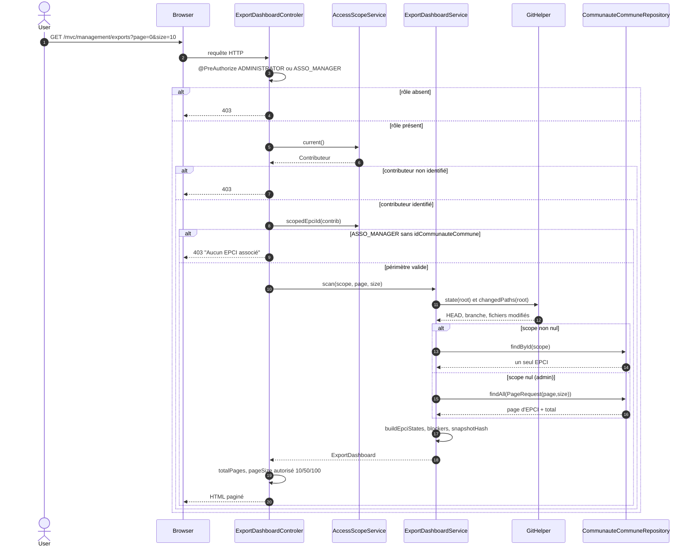
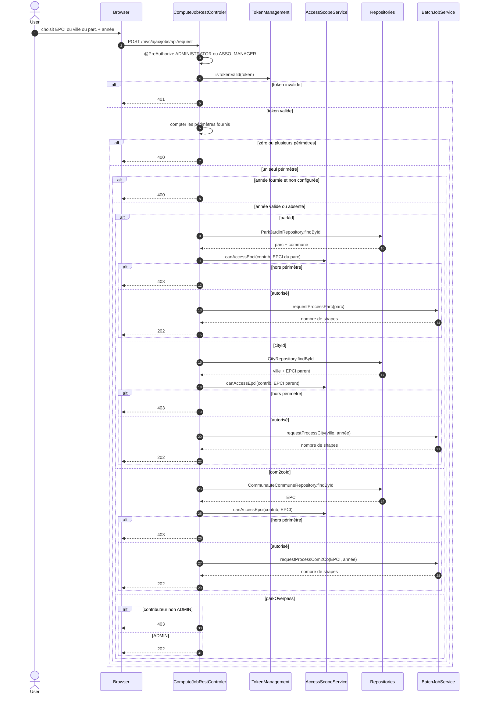
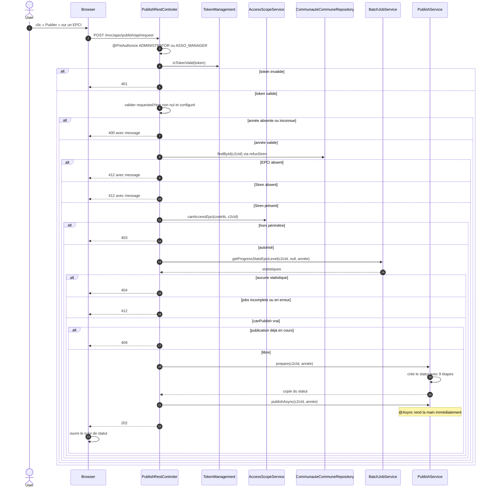
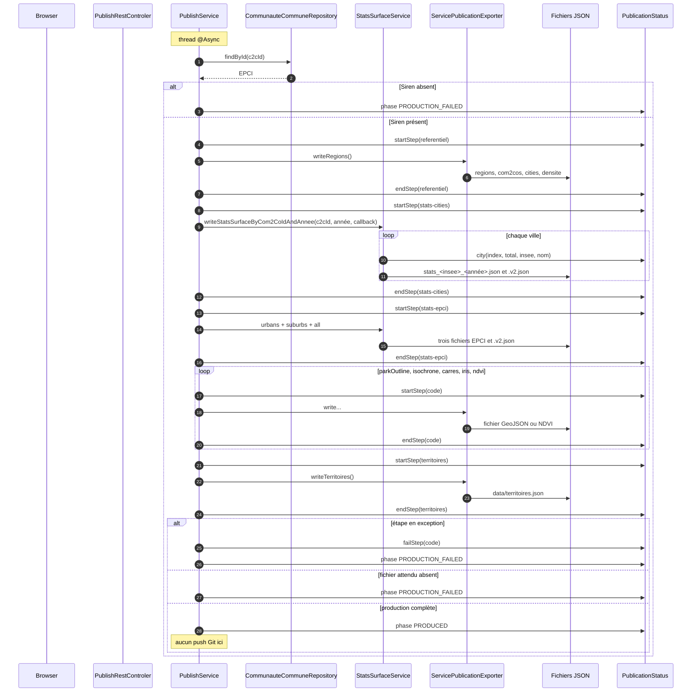
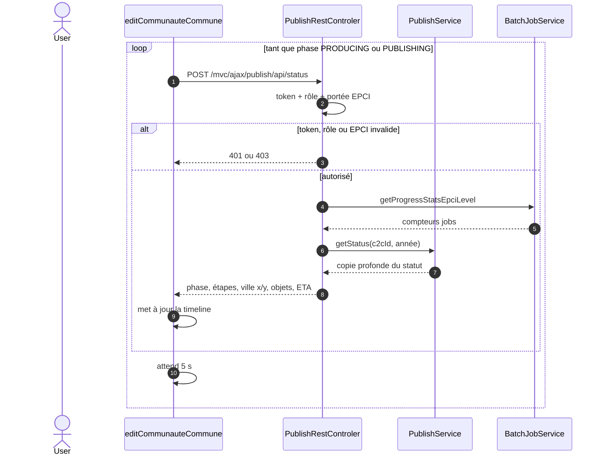
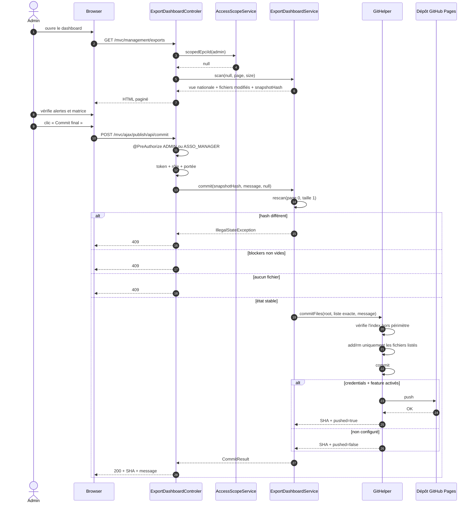
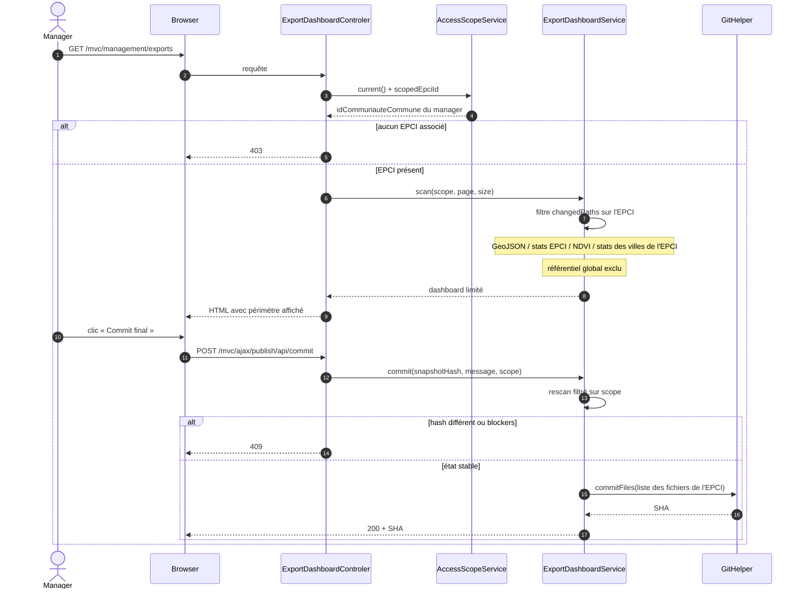
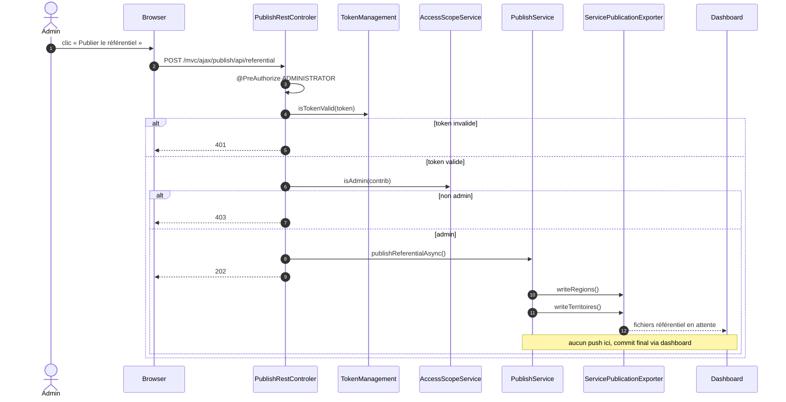

# Séquences — Exports IHM après évolution

Document de séquences. Complète `revue-exports-ihm-admutil.md`.
Date : 2026-11-22.
Périmètre : `geoservice-isochrone-v2`, après implémentation de :
- la progression de production longue ;
- la séparation production / commit final ;
- le dashboard d'état des lieux paginé ;
- la portée `ADMINISTRATOR` / `ASSO_MANAGER` limitée à l'EPCI du gestionnaire.

Aucun diagramme ne décrit l'ancien flux « publication = push immédiat ».

## 1. Accès au dashboard et portée utilisateur



Points de contrôle :

- Un gestionnaire ne peut pas élargir la page : `scope` est imposé par `idCommunauteCommune`.
- Un administrateur voit la vue nationale, paginée.
- Les alertes sont rendues dans une zone scrollable limitée à 10 lignes.

## 2. Demande de calcul : EPCI, ville, parc



Règles :

- `ADMINISTRATOR` : tout EPCI.
- `ASSO_MANAGER` : uniquement l'EPCI `idCommunauteCommune`, y compris via une ville ou un parc rattaché.
- `parkOverpass` reste réservé à l'administrateur.
- Les entités sont résolues par `findById` : une entité absente renvoie `404`, pas une exception lazy.

## 3. Demande de publication d'un EPCI



## 4. Production asynchrone et progression



- Les étapes sont pondérées : référentiel 8 %, stats villes 27 %, stats EPCI 10 %, parkOutline 10 %, isochrone 15 %, carreaux 15 %, IRIS 5 %, NDVI 5 %, territoires 5 %.
- `x/y villes` est alimenté par le callback de `StatsSurfaceService`.
- L'ETA est recalculée à chaque mise à jour, mais reste indicative.
- `territoires.json` est écrit après les stats, car il lit les fichiers de stats, mais il est classé référentiel dans le dashboard et le commit.

## 5. Suivi de statut et timeline IHM



La timeline affiche :

```text
✔ Référentiel            terminé
⟳ Stats par ville        12/95 villes
○ Park outline           en attente
○ Isochrones             en attente
○ Carreaux               en attente
○ IRIS                   en attente
○ NDVI                   en attente
○ Territoires            en attente
```

## 6. Commit final — administrateur



## 7. Commit final — gestionnaire limité à son EPCI



Un gestionnaire ne peut pas commiter :

- `data/regions.json` ;
- `data/com2cos/**` ;
- `data/cities/**` ;
- `data/territoires.json` ;
- les fichiers d'un autre EPCI.

## 8. Référentiel — administrateur uniquement



## 9. Table des responsabilités

| Composant | Rôle après évolution |
|---|---|
| `ComputeJobRestControler` | Valide token, périmètre unique, année, appartenance EPCI, puis crée les jobs. |
| `BatchJobService` | File de jobs, calculs, progression. |
| `PublishRestControler` | Valide token, année, Siren, rôle, portée EPCI, `canPublish`, verrou de publication. |
| `PublishService` | Produit les fichiers, met à jour `PublicationStatus`, s'arrête à `PRODUCED`. |
| `PublicationStatus` | Étapes, ville x/y, objets, fichiers, ETA. |
| `ExportDashboardControler` | Portée admin/manager, pagination 10/50/100. |
| `ExportDashboardService` | Scan, filtrage EPCI, blockers, hash de snapshot, commit final. |
| `GitHelper` | Commit d'une liste exacte, contrôle de l'index, push conditionnel. |
| `AccessScopeService` | Source unique de la portée `ADMINISTRATOR` / `ASSO_MANAGER`. |

## 10. Codes de retour

| Code | Cas |
|---|---|
| `202` | Calcul ou production accepté. |
| `400` | Périmètre multiple/absent, année absente ou inconnue. |
| `401` | Token invalide. |
| `403` | Rôle insuffisant, EPCI hors périmètre, manager sans EPCI, fichier interdit. |
| `404` | EPCI, ville ou parc inexistant ; aucune statistique de publication. |
| `409` | Publication déjà en cours, snapshot périmé, blockers, aucun fichier. |
| `412` | Siren absent, jobs incomplets ou en erreur. |
