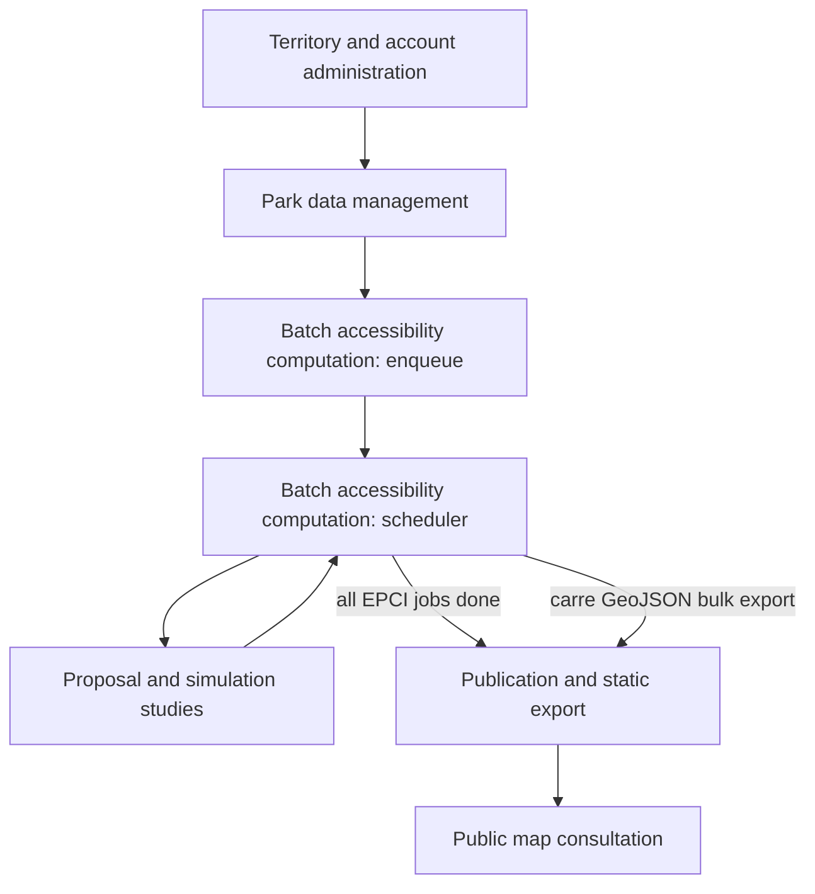

# Global Synthesis — geoservice-isochrone-v2

## Business Overview
The service measures and improves residents' access to municipal parks and gardens, checked against WHO recommendations (a sufficiently large green area within a short walk: 300 s in dense urban zones, up to 1200 s in suburban zones). It builds on French open data (INSEE 200m population grid and IRIS districts, IGN isochrones, OpenStreetMap/Overpass, cadastre, per-city park datasets) and produces per-grid-cell WHO indicators, park creation proposals, and finally published static GeoJSON map data for each communauté de communes (EPCI). Users are association contributors (park declaration, entrances, proposals) and administrators (compute, publication, account and territory management).

## Business Processes

### Process: Public map consultation
Entry point for anonymous and logged-in visitors: pick region → communauté de communes → commune to locate the consultation map; the controller only orchestrates navigation lists and map centering before the published data is displayed.
- Triggers: `ConsultMapController` (HTTP)
- Details: [consult-map-controller.md](./consult-map-controller.md)

### Process: Territory and account administration
Administrators keep the reference structure sane: group each city into its communauté de communes (single link or bulk CSV import of INSEE codes) and manage contributor accounts (Argon2 passwords, password policies, brute-force throttling). These associations define what can be computed and published as one unit.
- Triggers: `CityAssociationControler` (HTTP), `ContributeurControler` (HTTP)
- Details: [city-association-controler.md](./city-association-controler.md), [contributeur-controler.md](./contributeur-controler.md)

### Process: Park data management
Contributors declare or adjust parks and their entrances: drawn Geoman shapes, cadastre-based commune relocation, photo processing with EXIF GPS, entrance isochrones refreshed from the IGN API and merged into the park's walkable polygon. This park polygon is the raw material of every accessibility computation; a deprecated prefecture pre-editor only flags records as processed.
- Triggers: `ParkNewControler` (HTTP), `EntranceControler` (HTTP), `ParkEditControler` (HTTP)
- Details: [park-new-controler.md](./park-new-controler.md), [entrance-controler.md](./entrance-controler.md), [park-edit-controler.md](./park-edit-controler.md)

### Process: Batch accessibility computation
Park changes and admin requests enqueue computations for the 200m cells and IRIS districts touched (scoped to the park's active years), and a 5-minute scheduler processes the queue to compute per-cell WHO indicators from the merged park polygons and IGN isochrones. Job recycling recovers crashed and errored jobs nightly; CPU-temperature overheat or shutdown suspends the worker.
- Triggers: `ComputeJobRestControler` (HTTP), `BatchJobService` (Scheduled)
- Details: [compute-job-rest-controler.md](./compute-job-rest-controler.md), [batch-job-service.md](./batch-job-service.md)

### Process: Proposal and simulation studies
Study tooling for associations: six optimization algorithms (iterative deficit, population-weighted, DBSCAN-clustered, constraint solver/PPC, chi-square, genetic) propose new park placements per commune; contributors can also draw manual proposals (circle/polygon) and simulate land projects on the map. Every study computes before/after WHO indicators per 200m cell and stores them for map overlays and decision-making.
- Triggers: `ParksPropositionController` (HTTP), `ManualProposalController` (HTTP), `ManualProposalGeoJsonController` (HTTP), `ProjectSimulatorController` (HTTP)
- Details: [parks-proposition-controller.md](./parks-proposition-controller.md), [manual-proposal-controller.md](./manual-proposal-controller.md), [manual-proposal-geojson-controller.md](./manual-proposal-geojson-controller.md), [project-simulator-controller.md](./project-simulator-controller.md)

### Process: Publication and static export
When all computations of an EPCI are finished, publication exports the grid-cell GeoJSON and the WHO statistics bands (dense/suburban, with threshold ranges) as static files into the published-data directory consumed by the public map. A legacy bulk exporter can regenerate the same grid files on demand; both write only files, never the source datasets.
- Triggers: `PublishRestControler` (HTTP), `FileExporterControler` (HTTP)
- Details: [publish-rest-controler.md](./publish-rest-controler.md), [file-exporter-controler.md](./file-exporter-controler.md)

## Overview (Macro Sequence)

## Coverage
| Component | Type | Associated process |
|---|---|---|
| BatchJobService | Scheduled | Batch accessibility computation |
| CityAssociationControler | HTTP | Territory and account administration |
| ComputeJobRestControler | HTTP | Batch accessibility computation |
| ConsultMapController | HTTP | Public map consultation |
| ContributeurControler | HTTP | Territory and account administration |
| EntranceControler | HTTP | Park data management |
| FileExporterControler | HTTP | Publication and static export |
| ManualProposalController | HTTP | Proposal and simulation studies |
| ManualProposalGeoJsonController | HTTP | Proposal and simulation studies |
| ParkEditControler | HTTP | Park data management |
| ParkNewControler | HTTP | Park data management |
| ParksPropositionController | HTTP | Proposal and simulation studies |
| ProjectSimulatorController | HTTP | Proposal and simulation studies |
| PublishRestControler | HTTP | Publication and static export |
