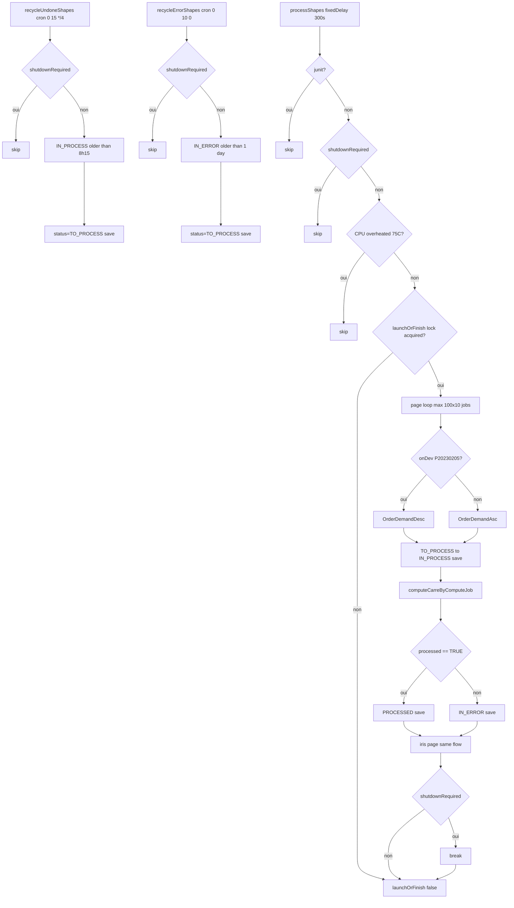

## BatchJobService → recycleUndone/recycleError/processShapes (@Scheduled)

Entrypoint: `BatchJobService.recycleUndoneShapes()` (`service/compute/BatchJobService.java:533`), `recycleErrorShapes()` (`:581`), `processShapes()` (`:656`) — cron `0 15 */4 * * *` | cron `0 10 0 * * *` | fixedDelay 300s
Last analyzed: 2026-10-22 (commit `e2d6454`)

### Business Context
Manage the compute backlog for INSEE 200m cells (`ComputeJob`) and IRIS districts (`ComputeIrisJob`) that underlies every published accessibility statistic. Three automatic passes: nightly recovery of crashed jobs (still `IN_PROCESS` after 8h15), nightly retry of jobs in error since at least one day, and a 5-minute worker loop that computes each queued cell/IRIS against the WHO park-accessibility criteria. The worker is skipped when the box is shutting down, under unit tests, or when CPU temperature exceeds the configured threshold, so slow thermal conditions never degrade the host.

### Business Rules
| ID | Service.method | Conditions | Actions | Source |
|---|---|---|---|---|
| RG-RCY-001 | `BatchJobService.recycleUndoneShapes()` | `shutdownRequired` | return, no work | `service/compute/BatchJobService.java:536-538` |
| RG-RCY-002 | `BatchJobService.recycleUndoneShapes()` | always | window = now − 8h15 | `service/compute/BatchJobService.java:542-545` |
| RG-RCY-003 | `BatchJobService.recycleUndoneShapes()` | carre jobs `IN_PROCESS` older than window non-empty | each: demand=now, status→**TO_PROCESS**, save (crash recovery) | `service/compute/BatchJobService.java:548-557` |
| RG-RCY-004 | `BatchJobService.recycleUndoneShapes()` | ⚠️ needs confirm: iris guard reuses `!jobs.isEmpty()` (carre list), not `irisJobs` | iris reset only if carre list non-empty | `service/compute/BatchJobService.java:559-567` |
| RG-RCY-011 | `BatchJobService.recycleErrorShapes()` | `shutdownRequired` | return | `service/compute/BatchJobService.java:584-586` |
| RG-RCY-013 | `BatchJobService.recycleErrorShapes()` | carre jobs `IN_ERROR` with processed ≤ now−1day non-empty | demand=now, status→**TO_PROCESS** (retry), save | `service/compute/BatchJobService.java:595-604` |
| RG-RCY-014 | `BatchJobService.recycleErrorShapes()` | ⚠️ needs confirm: same wrong guard `!jobs.isEmpty()` for iris block | needs confirm | `service/compute/BatchJobService.java:606-615` |
| RG-PRC-001 | `BatchJobService.processShapes()` | `isJUnitTest()` | return | `service/compute/BatchJobService.java:659-661` |
| RG-PRC-002 | `BatchJobService.processShapes()` | `shutdownRequired` | return | `service/compute/BatchJobService.java:663-666` |
| RG-PRC-003 | `BatchJobService.processShapes()` | `cpuTemperatureService.isCpuOverheated()` | return (inhibit batch) | `service/compute/BatchJobService.java:668-673` |
| RG-PRC-005 | `CpuTemperatureService.isCpuOverheated()` | `temp > cpuTempThreshold` (default 75 °C) | return true → batch skipped | `service/compute/CpuTemperatureService.java:96-99` |
| RG-PRC-011 | `BatchJobService.processShapes()` | loop max 100 pages × 10 | process ≤1000 carre jobs/cycle | `service/compute/BatchJobService.java:683-688` |
| RG-PRC-012 | `BatchJobService.onDev()` | hostname == `P20230205` | dev → LIFO; prod → FIFO | `service/compute/BatchJobService.java:691-695`, `:765-773` |
| RG-PRC-013 | `BatchJobService.processShapes()` | per carre job | status→IN_PROCESS + save; compute; `processed==TRUE`→PROCESSED else→**IN_ERROR**; save (`processed=now`) | `service/compute/BatchJobService.java:698-713` |
| RG-PRC-036 | `BatchJobService.processShapes()` | per page after carre loop; ⚠️ needs confirm: `possibleNext` uses `jobs.size()` (carre list), not `irisJobs.size()` | same IN_PROCESS→compute→PROCESSED/IN_ERROR cycle for IRIS jobs | `service/compute/BatchJobService.java:721-742` |
| RG-PRC-010 | `BatchJobService.launchOrFinish(false)` | `!jobIsRunning && !toLaunch` | throw `ExceptionAdmin(RG_IMPOSSIBLE_CASE)` | `service/compute/BatchJobService.java:467-474` |
| RG-PRC-020 | `ComputeCarreServiceV4.computeCarreByComputeJob()` | carre shape absent | return FALSE → job IN_ERROR | `service/park/ComputeCarreServiceV4.java:314` |
| RG-PRC-034 | `ComputeCarreServiceV4.computeCarreByComputeJob()` | any exception during compute | catch+log → return FALSE → job IN_ERROR | `service/park/ComputeCarreServiceV4.java:315-317` |
| RG-PRC-023 | `ComputeCarreServiceV4.isActive()` | `dateDebut==null`→1900, `dateFin==null`→2100; active iff `d<=annee<=f` | park lifecycle | `service/park/ComputeCarreServiceV4.java:664-685` |
| RG-PRC-025 | `ComputeCarreServiceV4.computeParkAreaOptim()` | `type.getStrict()` → OMS=type.oms; else override with `park.omsCustom` if non-null | OMS compliance flag | `service/park/ComputeCarreServiceV4.java:499-506` |
| RG-PRC-027 | `ComputeCarreServiceV4.computeCarreByComputeJob()` | `recoAtLeastParkSurface <= pac.surface` (cfg min_size=5000) | mark sufficient, union into OMS polygon, `withSufficient=true` | `service/park/ComputeCarreServiceV4.java:216-225` |
| RG-PRC-031 | `ComputeCarreServiceV4.computeMissingSurface()` | `isDense ? urbStandard : subUrb` (urban 10/12, sub 25/45); `missing>0` → value else ZERO | missing surface metrics | `service/park/ComputeCarreServiceV4.java:575-585` |
| RG-PRC-033 | `ServiceOpenData.isDistanceDense()` | density row absent → **TRUE (dense by default)**; present → TRUE iff codeDensite ∈ cfg `insee.densite` ("1,2") | density branch | `service/opendata/ServiceOpenData.java:78-92` |
| RG-PRC-035 | `CpuTemperatureService.isCpuOverheated()` | metrics endpoint unreachable, null body, or unknown line | return false → batch **not** inhibited (fail-open) | `service/compute/CpuTemperatureService.java:89`, `:105-108` |

### Sequence

