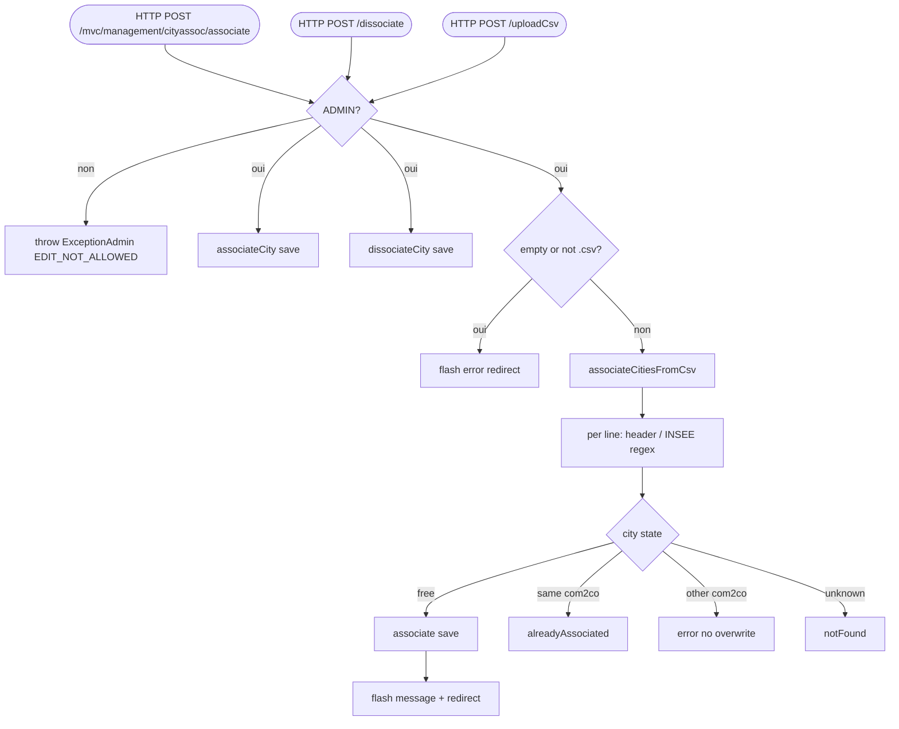

## CityAssociationControler → CityAssociationService (HTTP)

Entrypoint: `CityAssociationControler` — HTTP POST `/mvc/management/cityassoc/associate` (`controller/mvc/admin/CityAssociationControler.java:182`), HTTP POST `/mvc/management/cityassoc/dissociate` (`:216`), HTTP POST `/mvc/management/cityassoc/uploadCsv` (`:250`), HTTP GET `/mvc/management/cityassoc/list` (`:62`), HTTP GET `/mvc/management/cityassoc/edit` (`:102`)
Last analyzed: 2026-10-22 (commit `e2d6454`)

### Business Context
Groups the cities (communes) of a municipality-level body (EPCI / communauté de communes) so that statistics are computed and published per whole community of communes. Administrators link or unlink a city to its EPCI, or bulk-link many cities by uploading a CSV of INSEE codes. Non-admin users only see their own assigned community, in read-only mode.

### Business Rules
| ID | Service.method | Conditions | Actions | Source |
|---|---|---|---|---|
| RG-CAS-001 | role gate (all 3 POSTs) | principal `role != ADMINISTRATOR` | **throw `ExceptionAdmin("EDIT_NOT_ALLOWED")`** | `CityAssociationControler.java:193-195`, `:227-229`, `:261-263` |
| RG-CAS-002 | `CityAssociationService.associateCity()` | city==null OR com2co==null → return null (controller ignores, still redirects) | mutation: city.communauteCommune=com2co, cityRepository.save | `CityAssociationService.java:105-116`; call `CityAssociationControler.java:198` |
| RG-CAS-003 | `CityAssociationService.dissociateCity()` | city==null → null; else set communauteCommune=null | mutation: save city | `CityAssociationService.java:124-134`; call `:232` |
| RG-CAS-004 | uploadCsv pre-checks | `file.isEmpty()` → flash errorMessage + redirect; filename not `*.csv` (case-insensitive) → flash + redirect | reject | `CityAssociationControler.java:266-278` |
| RG-CAS-005 | `associateCitiesFromCsv()` | com2co id not found → error result, no processing | result only | `CityAssociationService.java:159-163` |
| RG-CAS-006 | CSV line rules | empty line → skip; line 1 containing `insee`/`code` → header skip; first column split `[,;\t]`; **must match `\d{5}`** else error | per-line validation | `CityAssociationService.java:169-190` |
| RG-CAS-007 | CSV city resolution | INSEE not found → notFound list; already linked to **same** com2co → alreadyAssociated; linked to **other** com2co → error (no overwrite); free → associate | mutation only in free case (cityRepository.save :209) | `CityAssociationService.java:193-213` |
| RG-CAS-008 | CSV IO error | IOException → error entry in result (transaction still commits prior lines — ⚠️ partial batch) | result | `CityAssociationService.java:216-219` |
| RG-CAS-009 | result messaging | hasErrors() \|\| notFound non-empty → warningMessage + uploadResult; else successMessage | flash attrs | `CityAssociationControler.java:284-301` |
| RG-CAS-010 | token | token rendered at `:169` but associate/dissociate/uploadCsv never validate it (Spring CSRF still applies to `/mvc/**`) | ⚠️ app-level anti-replay unused | `CityAssociationControler.java:169` vs `:182-306` |
| RG-CAS-011 | GET gates | non-admin list → redirect dashboard; non-admin edit without community → **throw `ExceptionAdmin("NO_COMMUNITY_ASSIGNED")`**; non-admin edit forced read-only own com2co | access rules | `:69-71`, `:113-122`, `:110` |

Transactionality: all 3 POSTs `@Transactional(READ_COMMITTED)` (`:183`, `:217`, `:251`).

### Sequence

