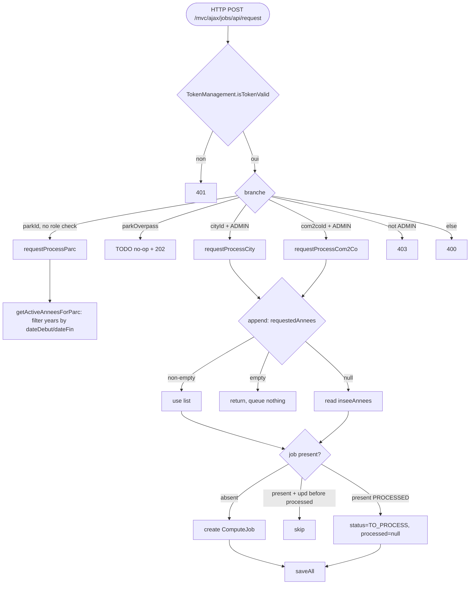

## ComputeJobRestControler → BatchJobService (HTTP)

Entrypoint: `ComputeJobRestControler.request()` (`controller/rest/ComputeJobRestControler.java:42`) — HTTP POST `/mvc/ajax/jobs/api/request`
Last analyzed: 2026-10-22 (commit `e2d6454`)

### Business Context
Feeds the accessibility compute backlog used by publication: for a park, a city or a whole EPCI, enqueue (or re-enqueue) the computation of WHO-threshold indicators for the 200m grid cells and IRIS districts they intersect. Year scope is either explicit (admin request for a given INSEE year) or derived from the park's opening/closing dates. Park-triggered requests need a valid anti-CSRF token but no particuliar role; city/EPCI requests are administrator-only.

### Business Rules
| ID | Service.method | Conditions | Actions | Source |
|---|---|---|---|---|
| RG-JOB-001 | `ComputeJobRestControler.request()` | `!isTokenValid` | return 401 | `controller/rest/ComputeJobRestControler.java:48-52` |
| RG-JOB-003 | `ComputeJobRestControler.request()` | `requestedYear != null` | keep year; else null (= all) | `controller/rest/ComputeJobRestControler.java:57-60` |
| RG-JOB-004 | `ComputeJobRestControler.request()` | `parkId != null` (⚠️ no role check) | `requestProcessParc(pj)` → nbCarre, 202 | `controller/rest/ComputeJobRestControler.java:62-67` |
| RG-JOB-005 | `ComputeJobRestControler.request()` | `parkId==null && parkOverpass != null` | TODO commented, nbCarre=0, 202 (no-op accepted) | `controller/rest/ComputeJobRestControler.java:68-73` |
| RG-JOB-006 | `ComputeJobRestControler.request()` | `cityId != null && role==ADMINISTRATOR` | `requestProcessCity`, 202 | `controller/rest/ComputeJobRestControler.java:74-78` |
| RG-JOB-007 | `ComputeJobRestControler.request()` | `com2coId != null && role==ADMINISTRATOR` | `requestProcessCom2Co`, 202 | `controller/rest/ComputeJobRestControler.java:79-83` |
| RG-JOB-008 | `ComputeJobRestControler.request()` | `role != ADMINISTRATOR` (no earlier match) | return 403 | `controller/rest/ComputeJobRestControler.java:84-88` |
| RG-JOB-009 | `ComputeJobRestControler.request()` | admin, no valid id | return 400 | `controller/rest/ComputeJobRestControler.java:89-92` |
| RG-JOB-011 | `BatchJobService.getActiveAnneesForParc()` | `cfgAnnees null/empty` | return `List.of()` (nothing queued) | `service/compute/BatchJobService.java:201-203` |
| RG-JOB-012 | `BatchJobService.getActiveAnneesForParc()` | `dateDebut==null`→1900; `dateFin==null`→2100 | park lifecycle bounds | `service/compute/BatchJobService.java:205-214` |
| RG-JOB-013 | `BatchJobService.getActiveAnneesForParc()` | `debut <= a <= fin` | keep configured year | `service/compute/BatchJobService.java:217-219` |
| RG-JOB-014 | `BatchJobService.requestProcessParc()` | always | `findCarreInMapArea`/`findIrisInMapArea` → `appendCarre`+`appendIris` | `service/compute/BatchJobService.java:174-182` |
| RG-JOB-015 | `BatchJobService.requestProcessCom2Co()` | for each city of com2co | sum `requestProcessCity` | `service/compute/BatchJobService.java:387-394` |
| RG-JOB-016 | `BatchJobService.requestProcessCity()` | `requestedYear != null ? List.of(year) : null` | year scope | `service/compute/BatchJobService.java:426` |
| RG-JOB-018 | `BatchJobService.appendCarre()` / `appendIris()` | requestedAnnees non-empty → use; empty → **queue nothing**; null → all inseeAnnees | year selection | `service/compute/BatchJobService.java:328-335`, `:250-257` |
| RG-JOB-019 | `BatchJobService.appendCarre()` | job exists: `upd!=null && processed!=null && upd.before(processed)` | skip (source older than last compute) | `service/compute/BatchJobService.java:350` |
| RG-JOB-020 | `BatchJobService.appendCarre()` | `!skip && status==PROCESSED` | status→TO_PROCESS, demand=now, processed=null | `service/compute/BatchJobService.java:353-356` |
| RG-JOB-021 | `BatchJobService.appendCarre()` | exists but not PROCESSED (or skip) | continue, no update | `service/compute/BatchJobService.java:357-359` |
| RG-JOB-022 | `BatchJobService.appendCarre()` | job absent | create new ComputeJob | `service/compute/BatchJobService.java:361-366` |
| RG-JOB-026 | `BatchJobService.appendIris()` | `shutdownRequired` after saveAll | set `shutdownReady=true` (SIGTERM handshake) | `service/compute/BatchJobService.java:300-302` |

### Sequence

