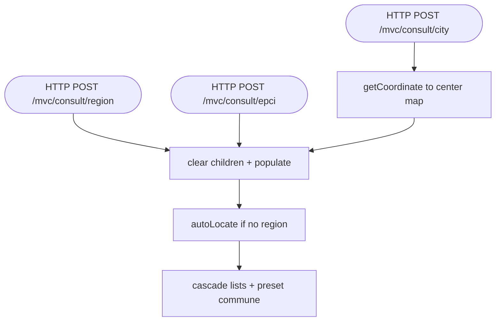

## ConsultMapController → ServiceReadReferences (HTTP)

Entrypoint: `ConsultMapController` — HTTP POST `/mvc/consult/region` (`controller/mvc/consult/ConsultMapController.java:47`), HTTP POST `/mvc/consult/epci` (`:54`), HTTP POST `/mvc/consult/city` (`:60`), HTTP GET `/mvc/consult` (`:37`)
Last analyzed: 2026-10-22 (commit `e2d6454`)

### Business Context
Entry page of the public consultation map: an anonymous or logged-in visitor picks a territory (region → EPCI/communauté de communes → commune) to view the published park-accessibility maps of the corresponding community of communes. The controller only prepares navigation lists and centers the map on the selected commune; it performs no computation and no mutation.

### Business Rules
| ID | Service.method | Conditions | Actions | Source |
|---|---|---|---|---|
| RG-CNS-001 | `changeRegion()` | always | clear idCommunauteDeCommunes, idCommune → repopulate | `controller/mvc/consult/ConsultMapController.java:47-52` |
| RG-CNS-002 | `changeEpci()` | always | clear idCommune → repopulate | `:54-58` |
| RG-CNS-003 | `changeCity()` | `idCommune != null` and coordinate found | set mapLng/mapLat from `ServiceReadReferences.getCoordinate` | `:60-70` |
| RG-CNS-004 | `populate()` | `idRegion==null` → `form.autoLocate()` (Contributeur context, else hardcoded region=9, com2co=1) | preset territory | `:77-79`; `AbstractFormLocate.java:45-62` |
| RG-CNS-005 | `populate()` list cascade | region set → load EPCI; EPCI set → cities by EPCI else by region; neither → empty lists | read | `:84-99` |
| RG-CNS-006 | `populate()` commune preset | `idCommune==null && communes non-empty` → first commune auto-selected | preset | `:116-119` |
| RG-CNS-007 | `populate()` names/center | region/EPCI names resolved by stream match; commune name via getCityById ⚠️ NPE if commune id stale; map center only if lat/lng null | read | `:101-130` |

### Sequence

### Notes
- Read-only controller — no mutations, no business exceptions (besides potential NPE above).
