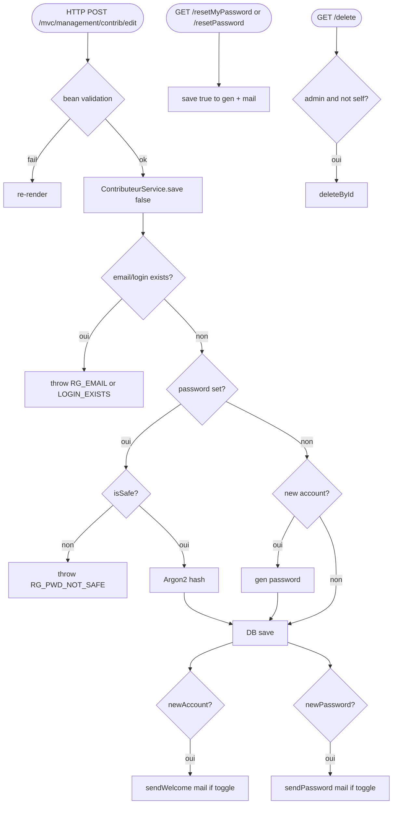

## ContributeurControler → ContributeurService (HTTP)

Entrypoint: `ContributeurControler` — HTTP POST `/mvc/management/contrib/edit` (`controller/mvc/admin/ContributeurControler.java:228`), HTTP GET `/mvc/management/contrib/resetMyPassword` (`:180`), HTTP GET `/mvc/management/contrib/resetPassword` (`:203`), HTTP GET `/mvc/management/contrib/delete` (`:98`), HTTP GET `/mvc/management/contrib/list` (`:78`)
Last analyzed: 2026-10-22 (commit `e2d6454`)

### Business Context
Manages contributor accounts (park contributors of associations) used to create and edit parks. Administrators create/edit/delete contributors and reset their passwords; contributors can edit their own profile and reset their own password. Password policy enforces WHO-grade strength and passwords are hashed with Argon2; account creation and password changes trigger Mailjet emails (globally disabled by the `sendEmail` feature flag).

> **Auth-risk flag**: two unguarded endpoints exist in this chain — `/resetPassword?id=` lets any authenticated user reset any account's password, and `/edit` does not check the `role` field, so a non-admin can POST `role=ADMINISTRATOR` and escalate privilege. See RG-CON-012 / RG-CON-015.

### Business Rules
| ID | Service.method | Conditions | Actions | Source |
|---|---|---|---|---|
| RG-CON-001 | `POST /edit` bean validation | `bindingResult.hasErrors()` (nom/prenom/login/email @NotEmpty etc.) | password cleared, re-render form, no service call | `ContributeurControler.java:242-246`; `FormContributor.java:22-37` |
| RG-CON-002 | self-edit side effect | `contribConnected.equals(contrib)` | copies region/com2co/commune onto connected principal before save | `ContributeurControler.java:250-254` |
| RG-CON-003 | `ContributeurService.save(contrib, false)` update path | id found; password non-empty and `!PasswordService.isSafe` | **throw `ExceptionAdmin(RG_PWD_NOT_SAFE)`** | `ContributeurService.java:138-142`; regex (≥12, lower, upper, digit, special) `service/admin/PasswordService.java:35-50` |
| RG-CON-004 | save — update + password change | password set; connected user id ≠ target id → newPassword=true (plaintext kept for mail) | mutation: hash via Argon2 `securizePassword` | `ContributeurService.java:144-153`; `AuthenticationConfig.java:131-159` |
| RG-CON-005 | save — create path | id null / not found → newAccount=true; email exists → **throw `RG_EMAIL_EXISTS`**; login exists → **throw `RG_LOGIN_EXISTS`**; force id=null, creationDate=now; empty password → pwdGenNeeded=true | throws / flags | `ContributeurService.java:156-186` |
| RG-CON-006 | save — pwdGenNeeded | true (reset paths call save(contrib,true) or create w/o password) | generate 20-char (min 12) password, hash, newPassword=true | `ContributeurService.java:188-195`; `PasswordService.java:57-81` |
| RG-CON-007 | save — field merge | always | nom/prenom/login/email/association/ids copied; role null → default `ASSOCIATION_CONTRIBUTOR`; DB contributeurRepository.save | `ContributeurService.java:198-214` |
| RG-CON-008 | save — welcome mail | newAccount | external `emailSender.sendWelcome` (skipped if `application.feature-flipping.sendEmail=false`, default false) | `ContributeurService.java:216-218`; `EmailSender.java:153-185` |
| RG-CON-009 | save — password mail | newPassword and target login ≠ connected login → sendPassword(...,login); else sendPassword(...) | external Mailjet; on IO/Mailjet failure → **throw `ExceptionAdmin`** (rolls back tx — ⚠️ password already changed in same tx so rolls back too) | `ContributeurService.java:220-231`; `EmailSender.java:81-151` |
| RG-CON-010 | controller ExceptionAdmin catch | any ExceptionAdmin from save | error message via i18n, re-render form (no rethrow) | `ContributeurControler.java:256-262` |
| RG-CON-011 | GET `/resetMyPassword` | always (self) | save(contrib, true) → regenerate + mail self | `ContributeurControler.java:180-195` |
| RG-CON-012 | GET `/resetPassword?id=` | ⚠️ **no admin/ownership check** — any authenticated user can reset any id | save(contrib, true) | `ContributeurControler.java:203-219` |
| RG-CON-013 | GET `/delete?id=` | not admin → redirect; id == self → redirect (no delete); else contributeurService.delete(id) | DB delete | `ContributeurControler.java:98-109`; `ContributeurService.java:107-109` |
| RG-CON-014 | GET `/list` | admin → findAll; else findByAssociation(own) | scope filter | `ContributeurControler.java:80-87` |
| RG-CON-015 | POST `/edit` role-scope | admin → all assos; else only own association shown ⚠️ role field itself not guarded: non-admin can POST role=ADMINISTRATOR — no check before save | ⚠️ privilege escalation candidate | list UI `:233-240`; save `:248-255`; service `ContributeurService.java:202-206` |

### Sequence

### Notes
- Password policy: ≥12 chars, lower, upper, digit, special — `service/admin/PasswordService.java:35-50`.
- ⚠️ `/resetPassword?id=` no admin/ownership guard; `/edit` role not guarded — privilege escalation candidates.
