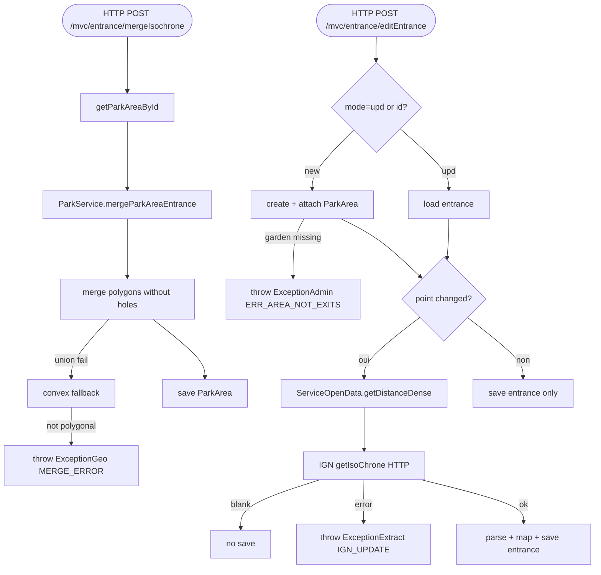

## EntranceControler → ParkService / ServiceOpenData (HTTP)

Entrypoint: `EntranceControler` — HTTP POST `/mvc/entrance/entrance` (`controller/mvc/entrance/EntranceControler.java:311`), HTTP POST `/mvc/entrance/mergeIsochrone` (`:322`), HTTP POST `/mvc/entrance/editEntrance` (`:341`), HTTP GET `/mvc/entrance` (`:62`)
Last analyzed: 2026-10-22 (commit `e2d6454`)

### Business Context
Maintains the access points (entrances) of a park: the contributor places an entrance on the map, and the service refreshes the IGN isochrone polygon — the area reachable by walking within 300m (dense zone) or 1200m (suburban zone) from that gate. Each entrance's isochrone polygon is then merged into the park's overall reachable polygon. This park polygon is the raw material of every accessibility computation.

### Business Rules
| ID | Service.method | Conditions | Actions | Source |
|---|---|---|---|---|
| RG-ENT-001 | `changeEntrance()` | always | re-populate form only (no mutation) | `controller/mvc/entrance/EntranceControler.java:311-314` |
| RG-ENT-002 | `ServiceReadReferences.getParkAreaById()` | ⚠️ no null check before mergeParkAreaEntrance | NPE if areaId invalid | `EntranceControler.java:327-329` |
| RG-ENT-003 | `ParkService.mergeParkAreaEntrance()` → `mergeEntranceAreas` | park contour is Polygon → seed merge with park shape; each entrance polygon merged via `GeoShapeHelper.mergePolygonsWithoutHoles`; union exception → convex-hull fallback; fallback result not Polygon/Multi → **throw `ExceptionGeo("MERGE_ERROR")`** | mutation: parkArea.polygon=merged, updated=now, parkAreaRepository.save | `ParkService.java:462-465`, `:426-454`; `GeoShapeHelper.java:218-251`, `:259-301` (throw `:298`) |
| RG-ENT-004 | controller saveEntrance mode | `entranceId != null \|\| "upd".equals(mode)` → load existing; else create new ⚠️ mode defaults `"upd"` (`FormParkEntranceDetail:65`) | branch update vs insert | `EntranceControler.java:346-358`; `FormParkEntranceDetail.java:65` |
| RG-ENT-005 | new entrance + `areaId!=null` | attach loaded ParkArea | sets relation | `EntranceControler.java:354-357` |
| RG-ENT-006 | point change detection | existing point ≠ new point → withIgn=true; point was null → withIgn=true; else false | decides IGN refresh | `EntranceControler.java:362-372` |
| RG-ENT-007 | `ParkService.saveEdited()` | parkArea null/id null: reuse existing area by gardenId; else load garden → create ParkArea (typeId default 1L if null); garden absent → **throw `ExceptionAdmin("ERR_AREA_NOT_EXITS")`**; DataIntegrityViolation → re-fetch concurrent area | DB create/attach ParkArea | `ParkService.java:143-185` |
| RG-ENT-008 | `ServiceOpenData.getDistanceDense()` | **reached only when withIgn=true** (called inside `saveEdited` :194); density row absent → "300"; codeDensite ∉ config `insee.densite` (`1,2`) → suburban `1200`; else urban `300`; city absent → default "300" | returns distance string for IGN call | `ParkService.java:188-197`; `ServiceOpenData.java:57-70`; `application.yml:126-139` |
| RG-ENT-009 | `ParkService.refreshIsochrone()` | withIgn=true: call IGN `getIsoChrone(coord, distance)`; blank response → log, no save; any exception → **throw `ExceptionExtract("IGN_UPDATE")`** | external HTTP call + DB save ParkEntrance with parsed polygon | `ParkService.java:213-238`; `ClientIsoChroneApiV2.java:74-111` |
| RG-ENT-010 | `saveEdited` else-branch | withIgn=false | DB save entrance only | `ParkService.java:199-201` |
| RG-ENT-011 | legacy | direct `getDistanceDense` call in controller commented out; field still injected unused | dead path | `EntranceControler.java:374-378` |
| RG-ENT-012 | GET `/goto` | any of idRegion/idComm2Co/idCommune == null → derive from park's city | prefill | `EntranceControler.java:93-107` |
| RG-ENT-013 | populateForm cascading resets | region change clears com2co+city; city change clears park+entrance; park change clears entrance id | form resets | `EntranceControler.java:226-303` |
| RG-ENT-014 | com2co/city autocomplete filters | txt blank → full list; else contains(txt) case-insensitive, limit(15) | read filter | `EntranceControler.java:240-258`, `:388-401` |

### Sequence

