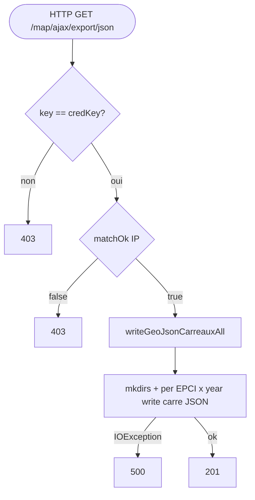

## FileExporterControler → ServicePublicationExporter (HTTP)

Entrypoint: `FileExporterControler` — HTTP GET `/map/ajax/export/json` (`controller/rest/FileExporterControler.java:47`)
Last analyzed: 2026-10-22 (commit `e2d6454`)

### Business Context
One-shot bulk export of the computed 200m grid-cell GeoJSON files for every EPCI of the territory and every configured INSEE year: it regenerates the static `carre_<year>_<epciId>.json` files consumed by the public consultation map. A shared credential key plus a (nominally) IP-restricted allowlist gate a call that writes the published dataset directory. Usually triggered manually after a batch of computations.

> **Auth-risk flag**: the endpoint is unauthenticated by design (`permitAll`) and its second gate — the IP allowlist — is effectively dead because of a boolean bug (see RG-EXP-003), leaving only the shared key as barrier.

### Business Rules
| ID | Service.method | Conditions | Actions | Source |
|---|---|---|---|---|
| RG-EXP-001 | Spring Security | `/map/**` → permitAll + CSRF ignored | endpoint **public**, only key+IP gate | `config/security/AuthenticationConfig.java:76-81`, `:98-105` |
| RG-EXP-002 | credKey check | `!this.credKey.equals(param key)` → **403 FORBIDDEN**, success=false | deny | `controller/rest/FileExporterControler.java:52-55`; config `application-prod.yml:30` (`EXPORT_KEY`), default `DEFAULT_KEY` |
| RG-EXP-003 | `matchOk(ip)` | `ip == "127.0.0.1"` → true; else credIp splits into 4 octets → loop `i<3`: `mem = mem \|\| creds[i].equals(ips[i])` with mem **initialized true** → ⚠️ **always true when credIp has 4 octets — IP allowlist effectively dead**; comment says intended AND but code is OR-from-true | 403 only when credIp malformed | `FileExporterControler.java:96-114` (loop `:106-111`) |
| RG-EXP-004 | `getClientIp()` | first non-empty header among X-Forwarded-For…REMOTE_ADDR, take part before `,` | spoofable via headers (public endpoint) | `FileExporterControler.java:116-145` |
| RG-EXP-005 | `ServicePublicationExporter.writeGeoJsonCarreauxAll()` | gates passed | filesystem mutation: mkdirs on `jsonFileFolder/geojson/carres`; for each EPCI × each `insee.annees` year → writeGeoJsonCarreaux → if features non-empty write `carre_<year>_<id>.json` | controller call `FileExporterControler.java:71`; `ServicePublicationExporter.java:149-163`, `:126-140` |
| RG-EXP-006 | `GeoMapServiceV2.findAllCarreByCommunauteCommune()` | per city: `findCarreByInseeCode(insee, TRUE)`; union into set; findAllCarreByArea | read queries building GeoJSON | `GeoMapServiceV2.java:1229-1245` |
| RG-EXP-007 | IOException family | StreamWriteException / DatabindException / IOException | **500 INTERNAL_SERVER_ERROR**, success=false | `FileExporterControler.java:75-84` |
| RG-EXP-008 | success | no exception | **201 CREATED**, success=true | `FileExporterControler.java:73-74` |

### Sequence

### Notes
- ⚠️ RG-EXP-003: intended behavior vs bug — as written IP check never fails for standard `a.b.c.d` configs.
- Endpoint public (permitAll) — only key + broken IP allowlist gate it.
