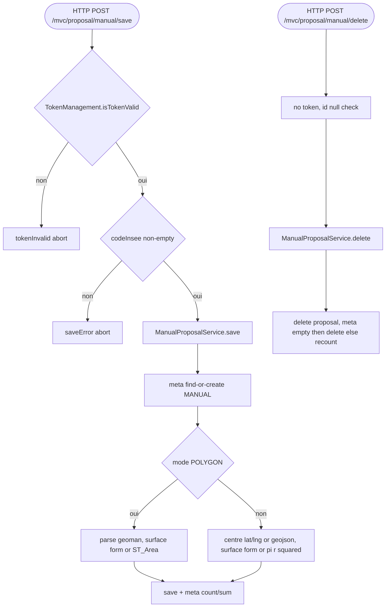

## ManualProposalController → ManualProposalService (HTTP)

Entrypoint: `ManualProposalController` — HTTP POST `/mvc/proposal/manual/save` (`controller/mvc/project/ManualProposalController.java:98`), HTTP POST `/mvc/proposal/manual/delete` (`:139`), HTTP GET `/mvc/proposal/manual` (`:55`)
Last analyzed: 2026-10-22 (commit `e2d6454`)

### Business Context
Lets an association contributor draw a missing park directly on the map: either as a polygon (traced with a drawing tool) or as a circle around a point, then record it as a MANUAL proposal grouped per commune and INSEE year. Proposals are studied/fed into impact evaluation before possibly materializing as real parks; aggregates (number of parks, total proposed surface) are kept on the meta object per commune/year.

### Business Rules
| ID | Service.method | Conditions | Actions | Source |
|---|---|---|---|---|
| RG-MAN-001 | `ManualProposalController.save()` | `!isTokenValid` | tokenInvalid=true, abort | `controller/mvc/project/ManualProposalController.java:102-107` |
| RG-MAN-002 | controller | `codeInsee` null/empty | saveError="Aucune commune sélectionnée", abort | `ManualProposalController.java:109-113` |
| RG-MAN-003 | `ManualProposalService.save()` | pass | saveSuccess; form reset keeping territory+annee | `ManualProposalController.java:116-127` |
| RG-MAN-004 | controller catch | any | saveError="Erreur: "+msg | `ManualProposalController.java:128-131` |
| RG-MAN-005 | `ManualProposalService.save()` | `annee` null | default `Year.now()` | `service/proposal/ManualProposalService.java:61` |
| RG-MAN-006 | meta | `(annee,insee)` miss | create meta `typeAlgo="MANUAL"`, save | `ManualProposalService.java:63-70` |
| RG-MAN-007 | update vs create | `form.id != null` | load existing proposal else new | `ManualProposalService.java:73-75` |
| RG-MAN-008 | geometry | `mode=="POLYGON"` and `sGeometry` not blank | parse Geoman → centre=centroid, contour=geom; surface: form.surface if set else PostGIS `getSurface(geom)` | `ManualProposalService.java:82-93` |
| RG-MAN-009 | geometry (circle/other) | `mode≠POLYGON` | centre from mapLng/mapLat or GeoJSON coords; surface: form.surface if set else π × (diameter/2)² | `ManualProposalService.java:94-119` |
| RG-MAN-010 | persistence | always | proposal save; meta numberOfParks=count, totalSurfaceOfParks=Σ surface, meta save | `ManualProposalService.java:121-135` |
| RG-MAN-011 | `ManualProposalController.delete()` | `form.id == null` | deleteError="Aucune proposition sélectionnée", abort | `ManualProposalController.java:143-146` |
| RG-MAN-012 | delete | ⚠️ no token check on /delete | delete runs without anti-replay | `ManualProposalController.java:139-157` |
| RG-MAN-013 | `ManualProposalService.delete()` | proposal found | delete proposal; reload remaining by meta: if empty → delete meta; else recompute numberOfParks + totalSurfaceOfParks | `ManualProposalService.java:150-173` |
| RG-MAN-014 | `ManualProposalService.findByInsee()` | meta null | `List.of()` | `ManualProposalService.java:196-199` |

### Sequence

### Notes
- Manuel: `MANUAL_PROPOSAL_CONTEXT.md` §3A thresholds (dense 300/10/3, suburban 500/25/8, SQUARE_DISTANCE 283) **stale** vs code+config (dense 300/12, suburban 1200/45, SQUARE_DISTANCE 120). Code wins.
