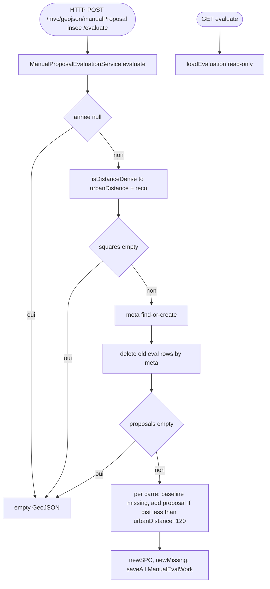

## ManualProposalGeoJsonController → ManualProposalEvaluationService (HTTP)

Entrypoint: `ManualProposalGeoJsonController` — HTTP POST `/mvc/geojson/manualProposal/{insee}/evaluate` (`controller/mvc/geojson/ManualProposalGeoJsonController.java:66`), HTTP GET `/mvc/geojson/manualProposal/{insee}` (`:40`), HTTP GET `/mvc/geojson/manualProposal/{insee}/evaluate` (`:53`)
Last analyzed: 2026-10-22 (commit `e2d6454`)

### Business Context
Measures, per 200m cell of a commune, how much the manually-drawn park proposals would improve the WHO accessibility indicators: baseline missing green surface per capita, added reachable surface for cells within crow-fly distance of a proposal (distance threshold + SQUARE_DISTANCE margin), recomputed surface-per-capita and missing surface. Results are stored as `ManualEvalWork` rows and returned as GeoJSON overlays for the study map.

### Business Rules
| ID | Service.method | Conditions | Actions | Source |
|---|---|---|---|---|
| RG-MEV-001 | controller | `annee` request param required | missing → Spring 400 | `controller/mvc/geojson/ManualProposalGeoJsonController.java:66-70` |
| RG-MEV-002 | `ManualProposalEvaluationService.evaluate()` | `annee == null` (defensive) | return empty GeoJsonRoot | `service/proposal/ManualProposalEvaluationService.java:76-79` |
| RG-MEV-003 | `ServiceOpenData.isDistanceDense()` | dense / unknown→**TRUE** | urbanDistance (300/1200), reco (12/45) — min not used | `ManualProposalEvaluationService.java:82-88` |
| RG-MEV-004 | squares | `findCarreByInseeCode(insee,true)` empty | return empty root | `ManualProposalEvaluationService.java:91-95` |
| RG-MEV-005 | meta | `(annee,insee)` miss | create `typeAlgo="MANUAL"` | `ManualProposalEvaluationService.java:98-106` |
| RG-MEV-006 | cleanup | always (before proposal check!) | `manualEvalWorkRepository.deleteByIdMeta(meta.id)` — old evals wiped even if no proposals | `ManualProposalEvaluationService.java:109` |
| RG-MEV-007 | proposals | none | return empty root (after cleanup) | `ManualProposalEvaluationService.java:112-116` |
| RG-MEV-008 | per-square eligibility | no `InseeCarre200mComputedV2` for year | continue (square skipped) | `ManualProposalEvaluationService.java:122-123` |
| RG-MEV-009 | baseline deficit | `accessingPopulation > 0` → `max(reco−spc,0) × localPopulation`; else 0 | missingSurface | `ManualProposalEvaluationService.java:138-144` |
| RG-MEV-010 | proposal accessibility | `centre != null` ∧ `surface > 0` ∧ `crowFlyDist < urbanDistance + SQUARE_DISTANCE(120)` | `newAccessingSurface += surface` | `ManualProposalEvaluationService.java:153-166` |
| RG-MEV-011 | new metrics | — | `popForDensity = accessingPop>0 ? accessingPop : localPop`; `newSPC = newAccess/popForDensity` (0 if pop 0); `newMissing = max(reco × localPop − newAccess, 0)` | `ManualProposalEvaluationService.java:169-177` |
| RG-MEV-012 | persistence | always (if loop reached) | build ManualEvalWork rows + GeoJSON features; `saveAll(works)` | `ManualProposalEvaluationService.java:179-211` |
| RG-MEV-013 | `loadEvaluation` (GET) | `annee null` / meta null / works empty | empty root | `ManualProposalEvaluationService.java:228-243` |
| RG-MEV-014 | evaluate endpoint | ⚠️ no token check on evaluate | — | — |

### Sequence

### Notes
- ⚠️ Evaluate wipes old `manual_eval_work` before checking proposals exist → data loss on empty proposals.
