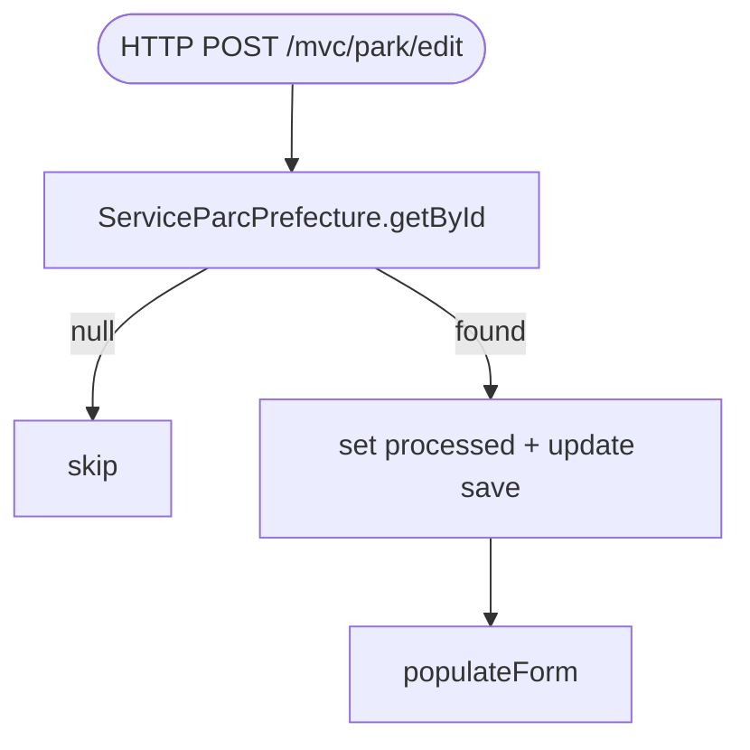

## ParkEditControler → ServiceParcPrefecture (HTTP, @Deprecated)

Entrypoint: `ParkEditControler` — HTTP POST `/mvc/park/edit` (`controller/mvc/park/ParkEditControler.java:89`), HTTP GET `/mvc/park/edit` (`:62`)
Last analyzed: 2026-10-22 (commit `e2d6454`)

### Business Context
Legacy preëditor for prefecture-supplied parks: only real business action is toggling the `processed` flag of a `ParcPrefecture` record (marking prefecture data as handled so it stops reappearing in review lists). The rest of the page is territory + park display data. Class is `@Deprecated` — the contributors prefer the newer park flows.

### Business Rules
| ID | Service.method | Conditions | Actions | Source |
|---|---|---|---|---|
| RG-EDT-001 | `ServiceParcPrefecture.getById()` | `parcPref == null` | skip update silently, no mutation | `controller/mvc/park/ParkEditControler.java:94-99` |
| RG-EDT-002 | `ServiceParcPrefecture.update()` | always (when found) | DB save ParcPrefecture (only field copied: processed) | `ParkEditControler.java:96-98`; `service/opendata/ServiceParcPrefecture.java:79-81` |
| RG-EDT-003 | `populateForm()` | `petj==null` | default map lat/lng Lille (50.628…,3.068…) | `ParkEditControler.java:139-158` |
| RG-EDT-004 | token | ⚠️ token issued at `:172` but POST /edit never validates token | no anti-replay on this endpoint | `ParkEditControler.java:89-108` vs `:172` |

### Sequence

### Notes
- Class `@Deprecated`. Light logic — mainly ParcPrefecture processed flag update.
