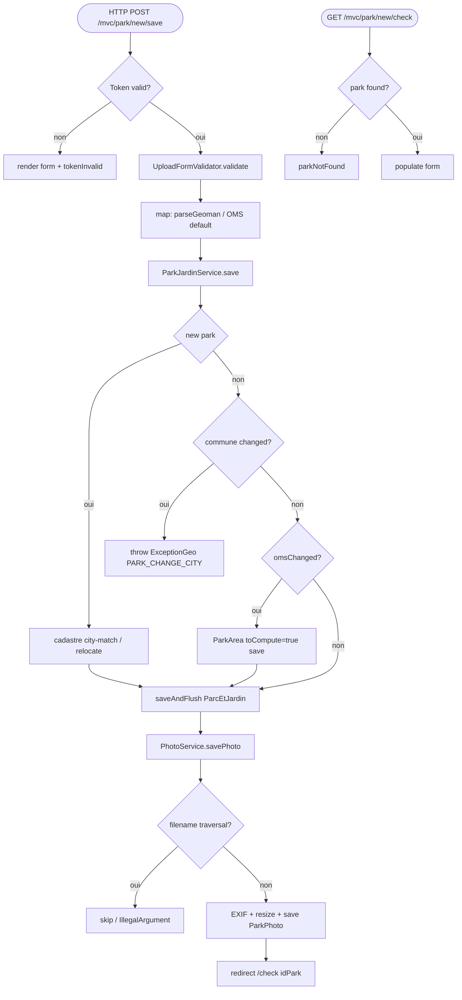

## ParkNewControler → ParkJardinService / PhotoService (HTTP)

Entrypoint: `ParkNewControler` — HTTP POST `/mvc/park/new/save` (`controller/mvc/park/ParkNewControler.java:266`), HTTP GET `/mvc/park/new/check` (`:164`), HTTP GET `/mvc/park/new` (`:338`)
Last analyzed: 2026-10-22 (commit `e2d6454`)

### Business Context
Association contributors declare a new park/garden (not present in city datasets): place it on the map, optionally draw its shape (Geoman polygon), pick park type and WHO-compliance override, upload a photo. The service validates the drawn shape, relocates the park to the right commune when the user's selection is wrong (cadastre lookup), refuses moving an existing park to another commune, and keeps computed park areas in sync when the WHO-compliance type changes. Photos are stored and processed (EXIF GPS, resize) with traversal protection.

> **Auth-risk flag**: file upload MIME/extension validation runs but its result is never checked — an invalid file still saves (photo pipeline itself is guarded). See RG-NEW-002.

### Business Rules
| ID | Service.method | Conditions | Actions | Source |
|---|---|---|---|---|
| RG-NEW-001 | `TokenManagement.isTokenValid()` | token malformed / HMAC mismatch / expired (prod 3600000 ms) → FALSE | early return view `newPark`, re-issue token, no save | `controller/mvc/park/ParkNewControler.java:272-286`; `TokenManagement.java:63-86` |
| RG-NEW-002 | `UploadFormValidator.validate()` | `fileupload != null` AND (MIME not in map OR mapped-extension ≠ filename extension) | `errors.rejectValue("fileupload")` ⚠️ **`hasErrors()` never checked → save proceeds anyway** | `UploadFormValidator.java:46-67`; call `ParkNewControler.java:288`, save continues `:290-296` |
| RG-NEW-003 | `ParkNewControler.map()` | `idPark != null` → load existing; else `new ParcEtJardin` + `source=AUTMEL` | always `status=TO_QUALIFY` | `ParkNewControler.java:184-193` |
| RG-NEW-004 | `map` OMS default | `omsCustom==null && typeId!=null` → `ParkTypeService.get(typeId)` | `pj.omsCustom = pt.getOms()` | `ParkNewControler.java:227-232`; `ParkTypeService.java:81-89` |
| RG-NEW-005 | `GeoJson2GeometryHelper.parseGeoman()` | `sGeometry` blank → skip; multiple `geometry` nodes → MultiPolygon, single → Polygon; parse error → swallowed | sets coordonnee=centroid, contour=geom; exception caught, save continues with null geometry | `ParkNewControler.java:235-252`; `GeoJson2GeometryHelper.java:78-121` |
| RG-NEW-006 | `ParkJardinService.save()` | new park (`id==null`): crow-fly city↔park `< 1` km → match=true, skip cadastre; else cadastre `contains(park point)`; `!match` → relocate by cadastre lookup (com2co → region → global) | mutation: `setCommune(relocatedCity)` if cadastre found; else keep user city | `ParkJardinService.java:77-131`; `DistanceHelper.java:22-43` |
| RG-NEW-007 | `ParkJardinService.save()` (update) | existing park AND `prev.commune ≠ new.commune` | **throw `ExceptionGeo("PARK_CHANGE_CITY")`** → transaction rollback | `ParkJardinService.java:135-138` |
| RG-NEW-008 | `ParkJardinService.save()` + omsChanged | update AND ParkArea exists AND (type null OR typeId changed OR (!strict && omsCustom changed)) | mutation: ParkArea.updated=now, toCompute=TRUE, copy type/oms, save | `ParkJardinService.java:141-151`, `:182-205` |
| RG-NEW-009 | `ParkJardinService.save()` surface | `source==AUTMEL` → `surfaceRepo.getSurface(contour)`; `updSurfaceShape` (sGeometry != null) → also surfaceContour; final saveAndFlush | DB insert/update ParcEtJardin | `ParkJardinService.java:156-172` |
| RG-NEW-010 | `PhotoService.savePhoto()` | `dto.photo.isEmpty()` → return null path (no-op); else create folders if absent | mkdir on photo paths | `PhotoService.java:48-61` |
| RG-NEW-011 | `PhotoService.map()` | filename contains `..` `/` `\` → return null (skip); resolved path not under storeRoot → throw `IllegalArgumentException("Invalid file path")` | traversal guard | `PhotoService.java:94-99`, `:110-115`, `:125-130` |
| RG-NEW-012 | `PhotoService.map()` | IO / ImageProcessing / IllegalState → throw `ExceptionPhoto` | blocks save | `PhotoService.java:69-78`; transferTo :117, sha256 :118, EXIF GPS :122, resize :132, DB save :66 |
| RG-NEW-013 | controller `etatAction` switch | `"new"/"add"/"edit"/"change"/"remove"` | ⚠️ all branches log-only, bodies commented — dead dispatch | `ParkNewControler.java:299-324` |
| RG-NEW-014 | PRG redirect | always after save | `redirect:/mvc/park/new/check?idPark=<id>` | `ParkNewControler.java:327` |
| RG-NEW-015 | GET `/check` | `getParcEtJardinById(idPark) == null` | model attr parkNotFound=true, return form (no throw) | `ParkNewControler.java:164-176` |
| RG-NEW-016 | `ServiceReadReferences.getCoordinate()` | cadastre geoShape: Point→coord, Polygon/MultiPolygon→centroid; fallback Laposte GPS ⚠️ **`coord[1], coord[1]` — lat used for both lng & lat (bug)** | sets map center | `ServiceReadReferences.java:242-274` (bug :269) |

### Sequence

