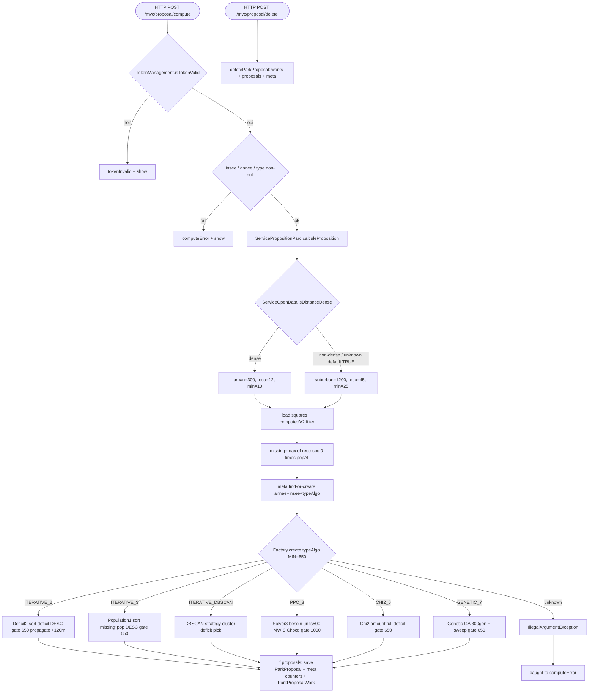

## ParksPropositionController → ServicePropositionParc (HTTP)

Entrypoint: `ParksPropositionController` — HTTP POST `/mvc/proposal/compute` (`controller/mvc/project/ParksPropositionController.java:127`), HTTP POST `/mvc/proposal/delete` (`:181`), HTTP GET `/mvc/proposal` (`:62`)
Last analyzed: 2026-10-22 (commit `e2d6454`)

### Business Context
Study tool for associations: for a commune and INSEE year, it runs an optimization algorithm that proposes where to create new parks so as many residents as possible reach at least 12 m² of accessible park per capita within 300m (dense zone, WHO recommendation) or 45 m² within 1200m (suburban). Each algorithm places hypothetical parks on the most deficitary 200m cells, propagates the "new" accessible surface to neighbor cells within reach, and stores the proposals with per-cell before/after metrics for map display and decision.

### Business Rules
| ID | Service.method | Conditions | Actions | Source |
|---|---|---|---|---|
| RG-PRO-001 | `ParksPropositionController.compute()` | `!isTokenValid(token)` | model tokenInvalid=true, no compute | `controller/mvc/project/ParksPropositionController.java:135-140` |
| RG-PRO-002 | controller | `codeInsee == null \|\| empty` | computeError="Aucune commune sélectionnée", abort | `ParksPropositionController.java:143-147` |
| RG-PRO-003 | controller | `annee == null` | computeError="sélectionner une année", abort | `ParksPropositionController.java:149-153` |
| RG-PRO-004 | controller | `type == null` | computeError="sélectionner un algorithme", abort | `ParksPropositionController.java:155-159` |
| RG-PRO-005 | `ServicePropositionParc.calculeProposition()` | validations pass | run compute, computeSuccess | `ParksPropositionController.java:165-168` |
| RG-PRO-006 | controller catch | any throwable | computeError="Erreur lors du calcul", show | `ParksPropositionController.java:170-173` |
| RG-PRO-007 | `ServicePropositionParc.getAvailableAlgorithms()` | GET show | model typeCalcul = 6 enum values (ITERATIVE_2, ITERATIVE_3, ITERATIVE_DBSCAN, PPC_3, CHI2_6, GENETIC_7) | `ParksPropositionController.java:70` → `ProposalComputationStrategyFactory.java:21-30` |
| RG-PRO-008 | `ServicePropositionParc.calculeProposition()` | `ServiceOpenData.isDistanceDense(insee)`: codeDensite ∈ `1,2` → dense; **unknown INSEE → defaults TRUE** | select threshold set | `ServicePropositionParc.java:121` → `ServiceOpenData.java:78-92` |
| RG-PRO-009 | thresholds | dense → urban(300, reco 12, min 10); non-dense → suburban(1200, reco 45, min 25) | set urbanDistance, reco, min | `ServicePropositionParc.java:123-134` |
| RG-PRO-010 | eligibility per square | `InseeCarre200mComputedV2` present for (annee,idInspire) | build ParkProposalWork; else skip | `ServicePropositionParc.java:142-143`, `:173-175` |
| RG-PRO-011 | deficit init | `missingSurface = max(reco − spc, 0) × popAll` | set missingSurface, clone New* fields | `ServicePropositionParc.java:156-171` |
| RG-PRO-012 | meta | `findByAnneeAndInseeAndTypeAlgo` miss → create+save | meta reused across recomputes | `ServicePropositionParc.java:185-192` |
| RG-PRO-013 | algo selection | `ProposalComputationStrategyFactory.create(typeAlgo, MIN_PARK_SURFACE=650)` | dispatch strategy | `ServicePropositionParc.java:197` |
| RG-PRO-014 | persistence | `proposals` non-empty | set idMeta, ppm.numberOfParks, ppm.totalSurfaceOfParks, saveAll proposals + ppm + work | `ServicePropositionParc.java:204-218` |
| RG-PRO-015 | persistence | `proposals` empty/null | log warn; no rows saved; meta left empty | `ServicePropositionParc.java:219-221` |
| RG-PRO-016 | `ProposalComputationStrategyFactory.create()` | unknown enum | throw `IllegalArgumentException("Unknown computation strategy type")` | `ProposalComputationStrategyFactory.java:47` |
| RG-PRO-017 | `IterativeComputationDeficit2Strategy` (ITERATIVE_2) | sort newMissingSurface DESC; stop if newSPC >= reco; amount = min(max(0,reco−spc)×pop, 40000); gate >= 650 → proposal; propagate delta to neighbors (dist < urbanDistance+120) | mutate ParkProposalWork | `IterativeComputationDeficit2Strategy.java:41-48`, `:111-196` |
| RG-PRO-018 | `IterativeComputationPopulation1Strategy` (ITERATIVE_3) | same as ITERATIVE_2 but sort = newMissingSurface × accessingPopulation DESC | same surface formula + gate 650 + neighbor propagation | `IterativeComputationPopulation1Strategy.java:30-44`, `:86-155` |
| RG-PRO-026 | `IterativeComputationDBSCANStrategy` (ITERATIVE_DBSCAN) | per iteration: re-cluster remaining deficit squares with DBSCAN eps=urbanDistance (haversine), minPts=3; rank clusters by total deficit DESC; pick most deficient square of best cluster; no cluster → fallback global deficit sort; then same math as ITERATIVE_2 (cap 40000, gate 650, neighbour spread) | choose next park cell by cluster deficit instead of global list | `IterativeComputationDBSCANStrategy.java:109-147` |
| RG-PRO-019 | `Solver3ComputationStrategy` (PPC_3) | UNIT_M2=500, MAX_UNITS=80, MIN_UNITS=2, MAX_ITER=20; besoinPropre = clamp(ceil((pop×reco−surf)/500),0,80); MWIS ≤20 iterations; Choco CP subset 10s; residual direct pass += residual×500; proposal iff addedM2>0; gate 1000 | mutate New* metrics | `Solver3ComputationStrategy.java:74-174`, `:191-204`, `:227-269`, `:298-463`, `:477-483`, `:509-535`, `:552-599` |
| RG-PRO-020 | `LeastSquaresNeighbour2Strategy` (CHI2_6) | maxIter = n×100; obs filter: pop>0 && deficitPerCapita>0 && spc ≤ min; amount = full deficit min(max(0,reco−spc)×pop, 40000); gate 650; χ² fit logged only | apply center + propagate | `LeastSquaresNeighbour2Strategy.java:104-241` |
| RG-PRO-021 | `Genetic1Strategy` (GENETIC_7) | pop max(200,min(n,2000)), 300 gens, cross 0.9, mut 0.25, elitism 0.05, tournament 5, sparsity 0.05; decode filters gene<650, pop==0, currentSPC≥min; post-GA sweep until top-deficit NewSPC≥min or pop==0 or surface<650 | GA evolve → decode → sweep | `Genetic1Strategy.java:61-72`, `:306-455`, `:493-585`, `:467-491` |
| RG-PRO-022 | `ServicePropositionParc.deleteParkProposal()` | meta found | delete parkProposalWork by composite ids, delete parkProposal, delete meta | `ServicePropositionParc.java:82-110` |
| RG-PRO-023 | same | meta absent | no-op silent | `ServicePropositionParc.java:84`, `:110` |
| RG-PRO-024 | `ParksPropositionController.delete()` | ⚠️ no token check on /delete (only /compute has one) | — | `ParksPropositionController.java:181-202` |
| RG-PRO-025 | recompute | ⚠️ needs confirm: recompute does not purge prior ParkProposal rows under same meta (only appends) | possible duplicates | `ServicePropositionParc.calculeProposition` |

Constants shared by strategies: `AT_LEAST_PARK_SURFACE=1000`, `MIN_PARK_SURFACE=650`, `CARRE_SURFACE=40000`, `SQUARE_DISTANCE=120` (`AbstractComputationtrategy.java:18-22`).

### Sequence

### Notes
- Doc `proposal-computation-strategy.md` says 5 algorithmes actifs — code lists **6** (`ITERATIVE_DBSCAN` present). Doc stale.
- Gate seuil: 650 (ITERATIVE_2/3, CHI2_6, GENETIC_7) vs 1000 (Solver3 MIN_UNITS) vs docs often say 1000 everywhere.
