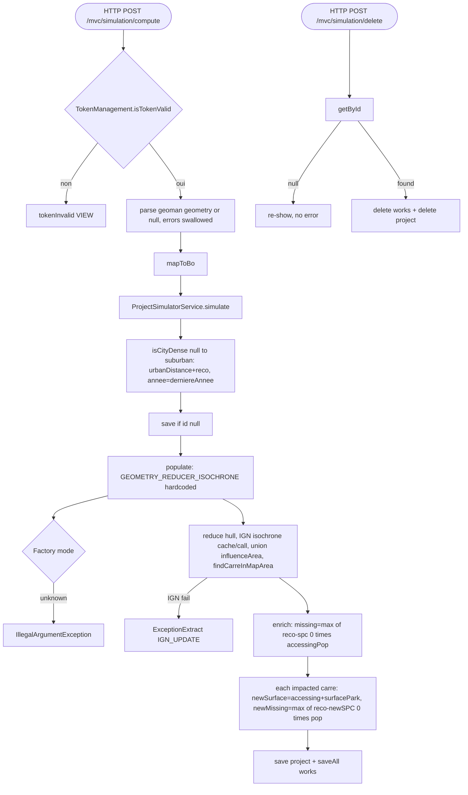

## ProjectSimulatorController → ProjectSimulatorService (HTTP)

Entrypoint: `ProjectSimulatorController` — HTTP POST `/mvc/simulation/compute` (`controller/mvc/project/ProjectSimulatorController.java:220`), HTTP POST `/mvc/simulation/delete` (`:187`), HTTP GET `/mvc/simulation` (`:62`)
Last analyzed: 2026-10-22 (commit `e2d6454`)

### Business Context
Pre-development impact simulator: an association draws a future land project (housing/rest/redevelopment) on the map with its resulting walkable park surface, and the service computes on which 200m cells this new park would land (IGN isochrones around the project shape) and the resulting before/after WHO indicators (surface per capita, missing surface). Used to validate projects against the accessibility target before committing to real works.

### Business Rules
| ID | Service.method | Conditions | Actions | Source |
|---|---|---|---|---|
| RG-SIM-001 | `ProjectSimulatorController.compute()` | `!isTokenValid(token)` | tokenInvalid=true, no simulate | `controller/mvc/project/ProjectSimulatorController.java:229-243` |
| RG-SIM-002 | `GeoJson2GeometryHelper.parseGeoman()` | `sGeometry` blank or contains `"features":[]` | geometry stays null | `ProjectSimulatorController.java:247-255` |
| RG-SIM-003 | same | parse throws | swallowed (log only), geometry null | `ProjectSimulatorController.java:256-258` |
| RG-SIM-004 | `mapToBo(form, geometry)` | `form.id != null` | load existing ProjectSimulator else new; copy fields; shapeArea=geometry, centerArea=centroid | `ProjectSimulatorController.java:261`, `:268-298` |
| RG-SIM-005 | `ProjectSimulatorService.simulate()` | always | `insee = city.inseeCode` | `service/project/ProjectSimulatorService.java:170-171` |
| RG-SIM-006 | `ServiceReadReferences.isCityDense()` | cityId null / city not found / density row missing → **null**; density code in list → true else false | dense (null ≠ dense → suburban branch via ternary) | `ProjectSimulatorService.java:174` → `ServiceReadReferences.java:210-235` |
| RG-SIM-007 | thresholds | dense → 300/12; else → 1200/45 | urbanDistance, reco | `ProjectSimulatorService.java:177-183` |
| RG-SIM-008 | year | always | `annee = derniereAnnee()` (max of inseeAnnees) | `ProjectSimulatorService.java:186` |
| RG-SIM-009 | insert | `id == null` | `projectSimulatorRepository.save` | `ProjectSimulatorService.java:193-195` |
| RG-SIM-010 | `populate()` | mode hardcoded | **`ModeRechercheCarre.GEOMETRY_REDUCER_ISOCHRONE`** active (NEIGHBORS commented, FIXME CHOOSE BEST ENGINE) | `ProjectSimulatorService.java:252-257` |
| RG-SIM-011 | `CarreRechercheStrategyFactory.getStrategy()` | unknown mode | throw `IllegalArgumentException("Mode de recherche inconnu")` | `CarreRechercheStrategyFactory.java:20-28` |
| RG-SIM-012 | `GeometryReducerIsochroneCarreRechercheStrategy.findCarres()` | always | reduce convex hull to 6–10 points; load IGN isochrone cache by (project,point); miss → call IGN `distance=urbanDistance`, sleep 80–130ms; union isochrones into influenceArea; delete orphans, save new; `findCarreInMapArea(merged, true)` → impacted squares | `GeometryReducerIsochroneCarreRechercheStrategy.java:57-118` |
| RG-SIM-013 | IGN call | blank response → null isochrone; any exception → throw `ExceptionExtract("IGN_UPDATE")` | | `GeometryReducerIsochroneCarreRechercheStrategy.java:132-142` |
| RG-SIM-014 | `populate` enrich | computed row missing | skip square | `ProjectSimulatorService.java:269-270`, `:299-301` |
| RG-SIM-015 | `populate` enrich | present | `densiteMissing=max(reco−spc,0)`; `missing = densiteMissing × accessingPopulation`; clone New* fields | `ProjectSimulatorService.java:284-297` |
| RG-SIM-016 | impact loop | for each impacted carre | `newSurface = accessingSurface + surfaceParkProjet` (project park added to **every** impacted carre); `newSPC = newSurface/popAccessing` (0 if pop 0); `newMissing = max(reco − newSPC, 0) × popAccessing` | `ProjectSimulatorService.java:210-232` |
| RG-SIM-017 | persist | always after loop | `save(projectSimulator, items)` → save project + saveAll work items | `ProjectSimulatorService.java:235`, `:97-112` |
| RG-SIM-018 | `delete(idCommune, idSimulator)` | always | deleteByIdProjectSimulator, deleteById(project); return remaining city projects | `ProjectSimulatorService.java:134-141` |
| RG-SIM-019 | controller delete | `getById(projectId) == null` | no error attr; re-show form unchanged | `ProjectSimulatorController.java:190`, `:209-210` |
| RG-SIM-020 | controller delete | found | `delete(idCommune, projectId)`, new form keeps only commune+coords | `ProjectSimulatorController.java:191-207` |
| RG-SIM-021 | density source | ⚠️ D uses `ServiceReadReferences.isCityDense` (**default null → suburban**) vs A/C use `ServiceOpenData.isDistanceDense` (**default dense=true** when unknown) | opposite defaults for missing data | — |

### Sequence

