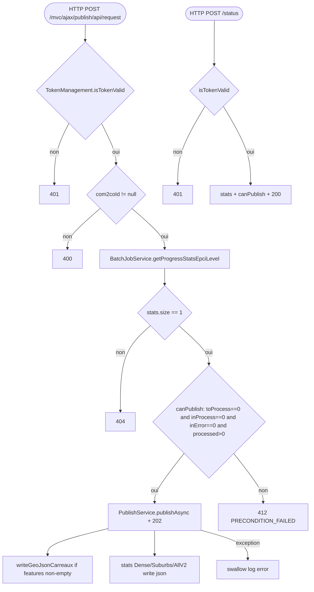

## PublishRestControler → PublishService / StatsSurfaceService (HTTP)

Entrypoint: `PublishRestControler.request()` / `.status()` (`controller/rest/PublishRestControler.java:58`, `:117`) — HTTP POST `/mvc/ajax/publish/api/request` | HTTP POST `/mvc/ajax/publish/api/status`
Last analyzed: 2026-10-22 (commit `e2d6454`)

### Business Context
Ends the compute pipeline: once every 200m/IRIS computation of a communauté de communes is finished, an admin can publish that EPCI — the service exports the grid-cell GeoJSON files and the WHO statistics bands (dense/suburban) as static JSON files into the published-data directory consumed by the public map. Request is asynchronous (202) and guarded by a token + roll-up preconditions; finish conditions are polled via `/status`.

> **Auth-risk flag**: token check is HMAC/time-based (1h validity) but the endpoint relies on the client-supplied token only; keep `EXPORT/auth` tokens private since they gate writing the public dataset.

### Business Rules
| ID | Service.method | Conditions | Actions | Source |
|---|---|---|---|---|
| RG-PUB-001 | `PublishRestControler.request()` | `!isTokenValid(token)` | return 401 | `controller/rest/PublishRestControler.java:64-68` |
| RG-PUB-002 | `TokenManagement.isTokenValid()` | decoded parts ≠ 2 (split `.`) | return false | `controller/mvc/validator/TokenManagement.java:66-69` |
| RG-PUB-003 | `TokenManagement.isTokenValid()` | `hmac != expected` (HMAC-SHA256) | return false | `controller/mvc/validator/TokenManagement.java:74-77` |
| RG-PUB-004 | `TokenManagement.isTokenValid()` | `now >= tokenTime + expirationMs` (3600000 ms) | return false (expired) | `controller/mvc/validator/TokenManagement.java:80` |
| RG-PUB-006 | `PublishRestControler.request()` | `requestedYear != null` | copy year; else year=null (= all years) | `controller/rest/PublishRestControler.java:72-75` |
| RG-PUB-007 | `PublishRestControler.request()` | `com2coId == null` | return 400 | `controller/rest/PublishRestControler.java:103-106` |
| RG-PUB-008 | `PublishRestControler.request()` | `stats == null \|\| stats.size() != 1` | return 404, no publish | `controller/rest/PublishRestControler.java:83,99-101` |
| RG-PUB-010 | `PublishRestControler.canPublish()` | `toProcess==0 && inProcess==0 && inError==0 && processed>0` | set canPublish flag | `controller/rest/PublishRestControler.java:146` |
| RG-PUB-011 | `PublishRestControler.request()` | `canPublish == true` | `PublishService.publishAsync(c2cId, year)`, return 202 | `controller/rest/PublishRestControler.java:91-94` |
| RG-PUB-012 | `PublishRestControler.request()` | `canPublish == false` | return 412 PRECONDITION_FAILED | `controller/rest/PublishRestControler.java:95-98` |
| RG-PUB-016 | `PublishService.publishAsync()` | com2co `findById` empty | throw `IllegalArgumentException` | `service/export/PublishService.java:42-43` |
| RG-PUB-017 | `PublishService.publishAsync()` | any exception in pipeline | swallow → log error (silent fail) | `service/export/PublishService.java:54-56` |
| RG-PUB-018 | `PublishService.publishAsync()` | always (@Async) | `writeGeoJsonCarreaux(com2co, year)` | `service/export/PublishService.java:46` |
| RG-PUB-019 | `PublishService.publishAsync()` | always | stats Dense + Suburbs + AllV2 | `service/export/PublishService.java:49-51` |
| RG-PUB-020 | `ServicePublicationExporter.writeGeoJsonCarreaux()` | `geojson!=null && !features.isEmpty()` | write `/geojson/carres/{id}/carre_{year}_{id}.json` | `service/export/ServicePublicationExporter.java:126-140` |
| RG-PUB-025 | `StatsSurfaceService.getStatsSurfaceByCom2CoAndAnneeAllDense()` | com2co `opt.isEmpty()` | return null, no file | `service/analytics/StatsSurfaceService.java:114-116` |
| RG-PUB-026 | `StatsSurfaceService.getStatsSurfaceByCom2CoAndAnneeAllDense()` | else | query dense + `populateSurface(seuil={0,3,7,10,12})` + write `stats_c2c_{id}_urbans_{year}.json` | `service/analytics/StatsSurfaceService.java:117-130` |
| RG-PUB-028 | `StatsSurfaceService.getStatsSurfaceByCom2CoAndAnneeAllSuburbs()` | else | `populateSurface(seuil={0,8,17,25,45})` + write suburbs json | `service/analytics/StatsSurfaceService.java:142-155` |
| RG-PUB-030 | `StatsSurfaceService.getStatsSurfaceByCom2CoAndAnneeAllV2()` | else | merge dense+suburbs by `seuil`, sum pops, write `…_all_…json` | `service/analytics/StatsSurfaceService.java:191-227` |
| RG-PUB-034 | `StatsSurfaceService.populateSurface()` | `populationTotalExclue > 0` | fold excluded pop into first bucket | `service/analytics/StatsSurfaceService.java:380-384` |
| RG-PUB-031 | `StatsSurfaceService.populateSurface()` | ⚠️ needs confirm: `surfaceMin==deb` → match=true but log says "Seuils incohérents" (condition/logic inverted?) | sets habitants or 0 | `service/analytics/StatsSurfaceService.java:341-344` |

### Sequence

